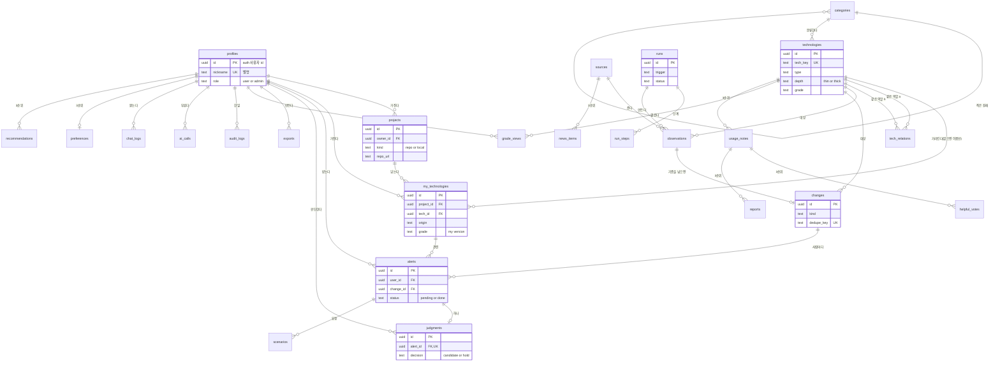

# ERD (DB 테이블 그림)

> **승인: 2026-11-18 회의**(김영식·차세일·황재웅, 바뀐 것 없음 — 회의 중 팀원이 전달). 이후 바뀌면 "바뀐 기록"에 이유를 적는다.

> 상태: **승인된 설계(11-18 회의). 실제 DB와 1차(11-18, P-30까지)·2차(11-19, P-18c까지) 대조 완료(7절, 표·칸 이름만), 팀 확인 대기.** erd 인터뷰 E1–E6(2026-11-18, 팀원 1명, 전부 추천대로)과 `docs/데이터설계.md`·`docs/spec.md` 10-1절을 바탕으로 Claude가 썼다. 새 팀 Supabase 프로젝트는 뼈대 단계에서 승인을 받아 만들고, 마이그레이션을 적용할 때마다 7절에서 대조한다(E5). P-8의 `alerts.run_id` 칸은 erd에 칸만 더했고 실제 DB와는 아직 대조하지 않았다.
> 범위: **1·2순위 테이블은 완전하게, 3순위 테이블은 "3순위"로 표시**(나중 마이그레이션), 노션 테이블은 다음 버전이라 넣지 않는다(E4).

## 0. 공통 규칙

| 규칙 | 내용 | 이유 |
|---|---|---|
| 기본키 | 모든 테이블 `id uuid` (기본값 `gen_random_uuid()`). `profiles.id`는 Supabase 로그인의 사용자 id와 같다 | 한 가지로 통일(E1) |
| 정해진 값 | DB enum 대신 **`text` + `check`(허용 값)** | 값을 바꾸는 마이그레이션이 쉬움(E2) |
| 시각 | 모두 `timestamptz`(UTC 저장), 화면에서만 한국 시간 | 정기 실행 06:00 KST와 Vercel(UTC)이 섞이지 않음(E3) |
| 지우기 | 사용자 데이터는 지우지 않고 `archived_at`·`hidden_at`으로 숨김 | 판단 기록 보존(데이터설계 원칙 7) |
| 시뮬레이터 | 가짜 줄에는 `is_simulated = true` | 시연 계정에만 알림, 표시된 줄만 지우기(SPEC-3.5) |
| 비밀값 | `run_steps`의 요약·오류는 저장 전에 가리기 함수를 거침 | SPEC-8 |
| RLS | **모든 테이블에 켬.** 판단 저장은 사용자 로그인 토큰으로만 | 불변 5, spec 10-1 |

## 1. 관계 그림

## 2. 테이블별 칸 (1·2순위)

표기: **필수**는 `not null`, PK 기본키, FK 외래키, UK 중복 금지. 모든 테이블에 `id uuid PK`와 `created_at timestamptz 필수`가 있어서 아래에서는 생략한다(다르면 적음).

### 2.1 사람

**profiles** — 사람(가입할 때 서버가 만듦)
| 칸 | 종류 | 필수 | 키 | 설명 |
|---|---|---|---|---|
| id | uuid | ✔ | PK, FK→auth.users | Supabase 로그인 id |
| nickname | text | ✔ | UK | 별명. "쓰고 있어요"에 보이는 이름(실명 아님, SQ9) |
| role | text | ✔ | | `user` / `admin`. 기본 `user`. 팀이 DB에서 직접 바꿈 |
| login_method | text | ✔ | | `google` / `email_test`(개발·QA 환경만) |
| is_public | bool | ✔ | | 내 기술 목록을 "쓰고 있어요"에 보이기. 기본 `true`(ADR 0009) |
| is_demo | bool | ✔ | | 시연 계정. 시뮬레이터 알림은 여기만 |

### 2.2 직접 입력

**projects** — 내 프로젝트
| 칸 | 종류 | 필수 | 키 | 설명 |
|---|---|---|---|---|
| owner_id | uuid | ✔ | FK→profiles | 주인 |
| kind | text | ✔ | | `repo` / `local`("프로젝트 밖(내 컴퓨터)") |
| name | text | ✔ | | 이름 |
| repo_url | text | | UK(owner_id와 함께) | 공개 GitHub 주소. `local`이면 비움 |
| memo | text | | | 메모 |
| archived_at | timestamptz | | | 보관(지우지 않음) |

`local`은 사람마다 하나(부분 UK: owner_id where kind='local').

**my_technologies** — 내 기술 목록의 한 줄
| 칸 | 종류 | 필수 | 키 | 설명 |
|---|---|---|---|---|
| owner_id | uuid | ✔ | FK→profiles | 주인 |
| project_id | uuid | ✔ | FK→projects | 어느 프로젝트 |
| tech_id | uuid | | FK→technologies | 카탈로그 기술. 이름만 직접 추가면 비움 |
| manual_name | text | | | 이름만 직접 추가한 기술. `tech_id`와 둘 중 하나는 꼭 있음(check) |
| origin | text | ✔ | | `repo`(저장소에서 읽음) / `manual`(직접 추가) / `import`(내 컴퓨터 목록 가져오기) |
| source_file | text | | | 어느 파일에서 읽었나 |
| version | text | | | 쓰는 버전(모르면 비움, SPEC-1) |
| unknown_origin | bool | ✔ | | 원본을 모르는 스킬(SPEC-7.3). 기본 `false` |
| hidden_at | timestamptz | | | 직접 숨김. 다시 읽어도 유지 |
| read_at | timestamptz | | | 마지막으로 읽은 시각 |
| collect_error_kind | text | | | 이 줄을 못 읽었을 때 오류 종류 |
| added_by | uuid | ✔ | FK→profiles | 누가 넣었나 |
| grade | text | ✔ | | **내 버전**의 보안 등급 `pass` / `caution` / `danger` / `unknown`. 기본 `unknown`. 쓰기는 서버 |
| grade_reason · grade_evidence · grade_rule_version · graded_at | text · jsonb · text · timestamptz | | | `technologies`의 같은 이름 칸과 같은 뜻, 단 이 줄의 `version` 기준 |
| last_checked_ok_at | timestamptz | | | 이 버전의 마지막 확인 성공 시각(SPEC-1 "수집 오류 (마지막 확인 …)") |

UK: (project_id, tech_id), (project_id, manual_name).

**왜 등급이 두 곳에:** OSV 취약점은 버전마다 다르다(0.1.15 위험, 0.1.16 아님). 기술 키에는 버전이 없어서 `technologies.grade` 한 칸에 쓰면 다른 사람이 다른 버전을 읽을 때 덮어쓴다. 그래서 **내 기술 목록·알림은 `my_technologies.grade`(내 버전)**를 보고, `technologies.grade`는 버전과 상관없는 판단(위험 패턴, 카탈로그·지도의 대표 등급)에 쓴다. 같은 기술·같은 버전을 쓰는 사람은 한 번 조회한 결과를 함께 받는다. 사용자는 이 칸들을 고칠 수 없다(고칠 수 있는 칸은 `hidden_at`·`manual_name`·`version`만).

### 2.3 기술 카탈로그 (공용)

**technologies** — 기술 하나
| 칸 | 종류 | 필수 | 키 | 설명 |
|---|---|---|---|---|
| tech_key | text | ✔ | UK | 기술 키(`npm:`, `pypi:`, `github:`, `mcp:`, `skill:`, `url:`, `hf:`, `service:`) |
| display_name | text | ✔ | | 보이는 이름 |
| type | text | ✔ | | `mcp` / `skill` / `plugin` / `sdk` / `model` / `service` / `concept` |
| category_id | uuid | | FK→categories | 작은 갈래 |
| category_set_by | uuid | | FK→profiles | 갈래를 정한 관리자(P-18c). 서버가 정한 갈래면 비움. 있으면 서버 분류가 덮어쓰지 않는다 |
| category_set_at | timestamptz | | | 관리자가 갈래를 정한 시각. `category_set_by`와 함께 있거나 함께 없음(check) |
| hosts | text[] | | | 쓰는 곳(Claude Code, Cursor …) |
| depth | text | ✔ | | `thin` / `thick` |
| thick_reasons | text[] | | | `used` / `same_role` / `official` / `popular` |
| status | text | ✔ | | `active` / `dormant` / `deprecated` / `gone`(데이터설계 8절) |
| status_by | text | | | 그 상태를 **정한 출처와 그때의 상태**: `github:<상태>`(보관·12개월 무활동·404 두 번) / `mcp_registry:<상태>`(레지스트리 중단·삭제, P-9c를 고친 뒤) / null(기본이거나 모름). 적힌 상태가 지금 `status`와 다르면 다른 쪽이 고친 것이라 정한 것으로 안 본다. GitHub 수집기는 **활동 중이거나 자기가 정한 상태만** 고친다. 활동 중인 줄에 남은 낡은 표시(다른 쪽이 status만 active로 고침)는 읽을 때 비운다(ADR 0021) |
| missed_count | int | ✔ | | 성공한 읽기에서 연속으로 못 찾은 횟수(2면 `gone`) |
| last_checked_ok_at | timestamptz | | | 마지막 확인 **성공** 시각(SPEC-1 수집 오류 표시) |
| collect_error_kind | text | | | 지금 수집 오류면 종류. 성공하면 비움 |
| one_liner | text | | | 한 줄 설명 |
| one_liner_source | text | | | 그 설명의 출처 링크 |
| repo_url · license | text | | | 저장소, 라이선스 |
| last_activity_at | timestamptz | | | 마지막 업데이트 |
| last_activity_kind | text | | | `release` / `commit` |
| is_official | bool | ✔ | | 공식 조직·레지스트리 |
| signals | jsonb | | | 인기 신호(주간 다운로드, skills.sh 설치 수, 별, 7일 증가, HN, HF) |
| category_score · category_rank | numeric · int | | | 갈래 안 점수와 순위 |
| out_of_rank_days | int | ✔ | | 30위 밖 연속 일수(14면 인기에서 빠짐) |
| grade | text | ✔ | | `pass` / `caution` / `danger` / `unknown`. 개념은 `unknown` 고정 |
| grade_reason | text | | | 쉬운 이유 |
| grade_evidence | jsonb | | | 근거 링크, 취약점 id, 파일·줄 |
| grade_rule_version | text | | | 규칙 버전(SPEC-1 v1) |
| graded_at | timestamptz | | | 등급 매긴 시각 |
| is_simulated | bool | ✔ | | 시뮬레이터가 넣은 기술 |

**categories** — 갈래(2단계)
| 칸 | 종류 | 필수 | 키 | 설명 |
|---|---|---|---|---|
| name | text | ✔ | UK(parent_id와 함께) | 이름 |
| parent_id | uuid | | FK→categories | 큰 갈래면 비움. 2단계까지만(앱에서 막음) |
| keywords | text[] | | | 분류 규칙 낱말 |

**tech_relations** — 같은 역할
| 칸 | 종류 | 필수 | 키 | 설명 |
|---|---|---|---|---|
| tech_a · tech_b | uuid | ✔ | FK→technologies | 작은 id가 a(check a<b) |
| kind | text | ✔ | | `same_role`(v1은 이것만) |
| status | text | ✔ | | `candidate` / `confirmed` |
| quote | text | | | 근거 원문 인용 |
| made_by | text | ✔ | | `seed`(처음 짝 목록) / `rule` / `ai` / `admin` |
| confirmed_by · confirmed_at | uuid · timestamptz | | FK→profiles | 확정한 관리자·시각 |
| is_simulated | bool | ✔ | | 시뮬레이터가 넣은 관계 |

UK: (tech_a, tech_b, kind).

**rule_lists** — 관리자가 고치는 목록(허용 패키지, GitHub 태그, HN 키워드, 위험 패턴)
| 칸 | 종류 | 필수 | 키 | 설명 |
|---|---|---|---|---|
| kind | text | ✔ | | `allow_package` / `github_topic` / `hn_keyword` / `risk_pattern` / `official_org`(공식 조직: 값은 이름공간 전체 `io.github.<소유자>`·`<tld>.<조직>`. 서버 이름의 이름공간과 같으면 두껍게, ADR 0019) |
| ecosystem | text | | | `npm` / `pypi` (패키지일 때) |
| value | text | ✔ | | 패키지 이름·태그·낱말·패턴 |
| pattern_id · pattern_grade | text | | | 위험 패턴이면 `P1`… / `danger`·`caution` |
| enabled | bool | ✔ | | 켜짐 |
| updated_by | uuid | | FK→profiles | 마지막으로 고친 관리자 |

UK: (kind, ecosystem, value).

### 2.4 수집

**sources** — 출처
| 칸 | 종류 | 필수 | 키 | 설명 |
|---|---|---|---|---|
| name | text | ✔ | UK | `osv`, `mcp_registry`, `github`, `npm_downloads`, `pypi_downloads`, `hf`, `hn`, `firecrawl_skills_sh` |
| method | text | ✔ | | `api` / `firecrawl` |
| priority | int | ✔ | | 1 / 3 |
| enabled | bool | ✔ | | 켜짐 |
| last_synced_at | timestamptz | | | 바뀐 것만 읽는 기준: 지난번 **전체 읽기를 시작한** 시각(공식 MCP 레지스트리, P-9c). 끝까지 읽은 뒤에만 올린다 |
| sync_started_at · sync_cursor | timestamptz · text | | | 한 실행에 다 못 읽었을 때 이어 가는 자리: 진행 중인 읽기의 시작 시각과 다음 쪽 커서(목록이 이름순이라 시각으로는 못 적는다). 끝나면 비운다 |

**runs** — 실행 한 번
| 칸 | 종류 | 필수 | 키 | 설명 |
|---|---|---|---|---|
| trigger | text | ✔ | | `schedule` / `manual` / `simulator` / `user_reread` / `first_read` / `scoring` (흐름 화면 시작 노드와 1:1) |
| started_by | uuid | | FK→profiles | 사람이 시작했으면 |
| project_id | uuid | | FK→projects | 다시 읽기·처음 읽기면 |
| status | text | ✔ | | `queued` / `running` / `succeeded` / `failed` / `partial` |
| started_at · finished_at | timestamptz | | | |
| item_count | int | ✔ | | 처리 건수 |
| attempt | int | ✔ | | 시도 횟수(최대 3) |
| next_retry_at | timestamptz | | | 다음 시도 |

**run_steps** — 실행 안의 단계(흐름 화면의 상자)
| 칸 | 종류 | 필수 | 키 | 설명 |
|---|---|---|---|---|
| run_id | uuid | ✔ | FK→runs | |
| step_name | text | ✔ | | `flow/flow.json`의 상자 이름 |
| status | text | ✔ | | `waiting` / `running` / `succeeded` / `failed` / `awaiting_judgment` |
| input_summary · output_summary | text | | | 가린 뒤의 요약 |
| api_url · http_status · duration_ms | text · int · int | | | 호출 내용(비밀값 제외) |
| count_in · count_out | int | | | 들어온 건수 · 나간 건수(흐름 화면 화살표 위 숫자) |
| branch_counts | jsonb | | | 분기 상자의 갈래별 건수. 예: `{"사건": 3, "변화 없음": 9, "수집 오류": 0}` |
| error_kind | text | | | `timeout` / `network` / `rate_limited` / `http_status` / `parse` |
| error_message | text | | | 가린 뒤의 오류 |
| started_at · finished_at | timestamptz | | | |

**observations** — 수집 자료(바뀐 값만)
| 칸 | 종류 | 필수 | 키 | 설명 |
|---|---|---|---|---|
| source_id | uuid | ✔ | FK→sources | |
| tech_id | uuid | ✔ | FK→technologies | |
| metric | text | ✔ | | `grade`, `version`, `activity`, `downloads`, `status`, `osv_vulns`(처음 읽기가 남기는 OSV 등급·취약점 목록), `osv_advisory`(시뮬레이터 보안 경고), `same_role`(같은 역할 새 기술, 시뮬레이터) … |
| prev_value · curr_value | jsonb | | | 이전 값 → 현재 값 |
| change_size | text | | | **바뀐 정도**(예: "등급 통과 → 위험(2단계)", "주간 다운로드 +12%", "새 버전 1.4.1 → 1.4.2"). 안내서의 같은 모양 칸. **지금 구현은 두 모양이 섞여 있다:** 처음 읽기는 `small`(등급 그대로)·`large`(등급이 바뀜), 시뮬레이터는 `large`, 다운로드 수집기(P-9)는 위와 같은 문장("주간 다운로드 +12%", "처음 읽음: 주간 N회")을 저장한다. 관리자 수집 자료 화면은 `large`·`small`·`none`을 큼·작음·없음으로 바꾸고 문장은 그대로 보여 준다. 한 가지로 통일할지는 정하지 않았다 |
| run_id | uuid | ✔ | FK→runs | |
| observed_at | timestamptz | ✔ | | |
| is_simulated | bool | ✔ | | |

### 2.5 사건과 판단

**changes** — 변경(공용)
| 칸 | 종류 | 필수 | 키 | 설명 |
|---|---|---|---|---|
| kind | text | ✔ | | `grade_to_danger` / `first_seen_danger` / `same_role_new` / `model_eol`(3순위) |
| tech_id | uuid | ✔ | FK→technologies | 대상(적용 기회면 새 기술) |
| version | text | | | |
| cause_id | text | ✔ | | 취약점 id / 패턴 id / 짝 기술 키 |
| danger_round | int | ✔ | | 위험이 된 회차(SPEC-3.1). 기본 1 |
| prev_value · curr_value | jsonb | | | |
| observation_id | uuid | | FK→observations | |
| dedupe_key | text | ✔ | UK | 중복 막기 키(SPEC-3.1·3.2) |
| draft_response · draft_sources | text · jsonb | | | 대응안 초안과 출처(변경마다 1번) |
| detected_at | timestamptz | ✔ | | |
| is_simulated | bool | ✔ | | |

**alerts** — 알림(사람마다)
| 칸 | 종류 | 필수 | 키 | 설명 |
|---|---|---|---|---|
| user_id | uuid | ✔ | FK→profiles | |
| change_id | uuid | ✔ | FK→changes | |
| my_technology_id | uuid | | FK→my_technologies | 관련된 내 기술 |
| kind | text | ✔ | | `security` / `opportunity` / `model_eol` |
| status | text | ✔ | | `pending`(판단 대기) / `done`(완료). 판단 저장으로만 바뀜 |
| comparison | jsonb | | | 적용 기회 비교표(항목마다 출처) |
| dedupe_key | text | ✔ | UK(user_id와 함께) | 사람 + 변경, 첫 점검은 사람 + 기술 + 버전 + 원인 |
| run_id | uuid | | FK→runs | 이 알림이 생긴 읽기 실행(P-8). 읽기를 실행한 본인의 알림에만 채우고 남의 알림은 비움(null = 연결된 실행 없음). 쓰기는 서버만 |

**judgments** — 판단(알림당 하나)
| 칸 | 종류 | 필수 | 키 | 설명 |
|---|---|---|---|---|
| alert_id | uuid | ✔ | FK→alerts, UK | 알림당 하나 |
| decision | text | ✔ | | `candidate`(적용 후보) / `hold`(보류) |
| reason | text | | | 보류면 5자 이상(check) |
| action | text | ✔ | | 한 조치: `candidate_recorded` / `hold_reason_recorded` (ADR 0010) |
| fixed_version | text | | | 보안 경고에서 적용 후보일 때 올릴 고친 버전(ADR 0012). 그 밖에는 비움 |
| action_result | text | | | 결과(예: 설치 프롬프트 기본 목록에 들어감) |
| judged_by | uuid | ✔ | FK→profiles | 알림 주인과 같아야 함(RLS) |
| judged_at | timestamptz | ✔ | | |

판단 저장과 `alerts.status = done`은 한 거래(DB 함수 하나)로 한다.

**scenarios** — 적용 시나리오(참고 자료)
| 칸 | 종류 | 필수 | 키 | 설명 |
|---|---|---|---|---|
| alert_id | uuid | ✔ | FK→alerts | |
| requested_by | uuid | ✔ | FK→profiles | |
| status | text | ✔ | | `generating` / `done` / `failed` |
| body | jsonb | | | 비교표, 적용 단계(공식 설치 명령만), 위험, 되돌리기 |
| sources | jsonb | | | 출처 |
| finished_at | timestamptz | | | |

### 2.6 내보내기, 기록, AI

**exports** — 설치 프롬프트·가져오기 한 번
| 칸 | 종류 | 필수 | 키 | 설명 |
|---|---|---|---|---|
| user_id | uuid | ✔ | FK→profiles | |
| kind | text | ✔ | | `install_prompt` / `local_import` |
| tech_count · excluded_danger_count | int | ✔ | | 넣은 수 / 위험이라 뺀 수 |
| imported_lines · rejected_lines | int | | | 가져오기에서 받은 줄 / 뺀 줄 |

프롬프트 글 자체는 저장하지 않는다(같은 목록이면 같은 글을 다시 만든다).

**grade_views** — 등급 이유를 연 기록(주 숫자, E6)
| 칸 | 종류 | 필수 | 키 | 설명 |
|---|---|---|---|---|
| user_id | uuid | ✔ | FK→profiles | |
| tech_id | uuid | ✔ | FK→technologies | |
| viewed_at | timestamptz | ✔ | | |

주 숫자 = 내 기술 중 `grade_views`가 하나라도 있는 기술 수 ÷ 내 기술 수.

**audit_logs** — 바꾼 기록(덧붙이기만)
| 칸 | 종류 | 필수 | 키 | 설명 |
|---|---|---|---|---|
| actor_id | uuid | | FK→profiles | 서버가 한 일이면 비움 |
| actor_role | text | ✔ | | `user` / `admin` / `server` |
| action | text | ✔ | | `manual_add`, `hide`, `unhide`, `run_now`, `classify`, `confirm_relation`, `role_change`, `hide_note`, `clear_simulator` … |
| target_table · target_id | text | ✔ | | 대상 |
| reason | text | | | 관리자는 필수(앱에서 막음) |

**ai_calls** — Claude 호출 기록
| 칸 | 종류 | 필수 | 키 | 설명 |
|---|---|---|---|---|
| purpose | text | ✔ | | `draft` / `scenario` / `classify` / `chatbot` |
| user_id | uuid | | FK→profiles | 사람이 요청했으면 |
| input_hash | text | ✔ | | 같은 입력은 다시 보내지 않음 |
| tokens_in · tokens_out | int | | | |
| status | text | ✔ | | `succeeded` / `failed` |
| error | text | | | |

하루 한도(SPEC-9)는 이 테이블을 세서 건다.

**chat_logs** — 위키 챗봇(팀원·관리자만)
| 칸 | 종류 | 필수 | 키 | 설명 |
|---|---|---|---|---|
| user_id | uuid | ✔ | FK→profiles | |
| question · answer | text | ✔ | | 답 800자 안 |
| wiki_pages | text[] | | | 찾은 쪽 |

## 3. 3순위 테이블 (나중 마이그레이션)

| 테이블 | 칸 (id·created_at 외) | 키·규칙 |
|---|---|---|
| **user_tastes** (P-23, 처음 계획의 `preferences`) | user_id(PK, FK), build text, tools text[], interests text, created_at | 사람당 하나, 관리자 못 봄. 건너뛰기는 빈 값으로 저장, 질문을 아직 안 봤으면 줄이 없음. 열 권한: 쓰는 세 칸만(`supabase/tests/user_tastes_p23.sql`) |
| **recommendations** | user_id FK, tech_id FK, reason, signals jsonb, reaction(`interested`/`not`/`none`) | UK(user_id, tech_id) |
| **usage_notes** | author_id FK, tech_id FK, used_for, result, tip(합쳐 500자 안), helpful_count(서버 칸, 투표 트리거가 올림), hidden_at, hidden_by | 등급에 영향 없음, Claude에 넣지 않음. 수정·삭제 없음(숨김만, 관리자). 숨긴 글은 쓴 사람·관리자만 읽음(P-24) |
| **helpful_votes** | note_id FK, user_id FK | PK(note_id, user_id), 자기 글엔 못 누름(앱·DB 함수) |
| **reports** | note_id FK, reporter_id FK, reason, handled_by, handled_at, handle_reason | 관리자 처리 |
| **news_items** | source_id FK, title, url, hosts text[], tech_key, published_at | UK(url), 공식 출처만 |

## 4. 접근 규칙 (RLS, 테이블별 한 줄)

| 테이블 | 규칙 |
|---|---|
| profiles | 본인 읽기·별명·공개 여부 고치기, `role` 못 바꿈. 관리자 전체 읽기 |
| projects · my_technologies | 본인 읽기·쓰기(보관·숨김). 관리자 읽기만 |
| technologies · categories · tech_relations | 모두 읽기. 쓰기는 서버, 관리자는 갈래·관계 확정만(technologies는 `category_id`·`category_set_by`·`category_set_at` 세 칸, 본인 이름·작은 갈래만, P-18c) |
| rule_lists · sources | 관리자 읽기·쓰기. 사용자 못 봄(허용 목록은 서버가 씀) |
| runs · run_steps | 본인이 시작한 `user_reread`·`first_read`만 읽기. 관리자 전체 읽기, 지금 실행 |
| observations · changes | 본인 알림에 이어진 것만 읽기. 관리자 전체 읽기. 쓰기는 서버 |
| alerts | 본인 읽기. 만들기는 서버. `status`는 판단 저장 함수로만 바뀜 |
| judgments | **본인 알림에만, 사용자 로그인 토큰으로만 만들기.** 관리자 읽기만. 서비스 키로 쓰는 코드 없음(테스트) |
| scenarios | 본인 알림에 요청·읽기. 관리자 읽기 |
| exports · grade_views | 본인 읽기·만들기. 관리자 읽기 |
| audit_logs | 본인 줄 읽기, 관리자 전체 읽기. **고치기·지우기 아무도 못 함** |
| ai_calls | 관리자 읽기. 쓰기는 서버 |
| chat_logs | 관리자(팀원) 읽기·만들기 |
| "쓰고 있어요" | 테이블이 아니라 서버 함수. `is_public = true`인 사람의 별명과 수만 돌려줌 |
| (3순위) | preferences 본인만 / recommendations 본인 / usage_notes 모두 읽기·본인 쓰기 / helpful_votes 본인 줄 / reports 본인 만들기·관리자 처리 / news_items 모두 읽기 |

## 5. 고른 이유와 접은 방법

- **변경(`changes`)과 알림(`alerts`)을 나눔:** 바깥 변화는 한 번만 저장하고 사람마다 알림을 만든다. 중복 금지 키 두 개로 불변 3을 DB가 지킨다. *접은 방법:* 알림 테이블 하나에 다 넣기 → 같은 변화가 사람 수만큼 저장되고 중복 막기가 어려움.
- **판단(`judgments`)을 별도 테이블, 알림당 하나:** 판단과 상태 변경을 한 거래로 묶어 불변 4를 지킨다. *접은 방법:* `alerts`에 판단 칸 넣기 → 누가·언제·한 조치를 따로 남기기 어려움.
- **글자 칸 + 허용 값 검사, uuid 통일:** 초보 팀이 값을 바꾸기 쉽다. *접은 방법:* DB enum, 숫자 id 섞어 쓰기(이전 프로토타입).
- **관리자가 고치는 목록을 `rule_lists` 하나로:** 허용 목록·태그·키워드·위험 패턴을 화면 하나(IA-17)에서 고친다. *접은 방법:* 코드 안에 고정 → 바꿀 때마다 배포.

## 6. 데이터설계와 다른 곳

| 무엇 | 데이터설계 | 여기 | 이유 |
|---|---|---|---|
| 관리자가 고치는 목록 | 8절에 "관리자가 고친다"만 있음 | `rule_lists` 테이블 | 저장할 곳이 필요 |
| 시연 계정 | 없음 | `profiles.is_demo` | 시뮬레이터 알림을 시연 계정에만(SPEC-3.5) |
| 연속으로 못 찾은 횟수 | "2번 연속"만 | `technologies.missed_count` | 판정에 숫자가 필요 |
| 노션 테이블 | 다음 버전 설계로 있음 | 없음 | E4 |

## 7. 실제 DB와 대조한 결과

**1차 대조: 2026-11-18, Claude**(Supabase 커넥터 `list_tables`, 프로젝트 `techradar`). P-2 마이그레이션(`supabase/migrations/202611181400_P-2_m0_tables.sql`, `202611181415_P-2_lock_functions.sql`)을 적용한 뒤. **팀 확인 대기**(안내서: 대조는 팀이 한다). 결과는 `docs/qa.md`에도 남겼다.

| 테이블 | erd에 있음 | 실제 DB에 있음 | 칸·키·RLS 같음 | 다르면 고친 쪽과 이유 |
|---|---|---|---|---|
| profiles · projects · my_technologies · technologies · sources · runs · run_steps · observations · changes · alerts · audit_logs | ✔ | ✔ (RLS 켜짐) | ✔ | — |
| categories | ✔ (2.3) | ✔ | ✔ | P-30 대신 P-2에서 만듦: `technologies.category_id`가 가리켜서 |
| judgments | ✔ | ✔ | `fixed_version` 칸이 DB에 있음 | erd 표에도 `fixed_version` 줄이 있다(ADR 0012, PR #28 합침). 둘이 같다 |
| my_technologies 내 버전 등급 칸 (2026-11-18, P-3) | ✔ (2.2) | ✔ 6칸, 사용자 고치기 권한은 `hidden_at`·`manual_name`·`version`만 | ✔ | 마이그레이션 `202611181600_P-3_my_tech_grade.sql`(DB 이름 `p3_my_tech_grade`). 시험 4개 기대값 |
| rule_lists · tech_relations · grade_views · scenarios · exports · ai_calls · chat_logs (2026-11-18, P-30) | ✔ | ✔ (RLS 켜짐, 공개 테이블 20개 모두 켜짐) | ✔ | 마이그레이션 `202611181700_P-30_m1_tables.sql`(DB 이름 `p30_m1_tables`). erd에 없던 것을 더함: `rule_lists` 종류별 칸 check, `tech_relations` 확정 ⇔ 확정 시각 check, 7개 모두 지우기 금지, 관리자는 관계의 확정 칸 3개만 고침, 사용자는 시나리오의 요청 칸 2개만 넣음(보안 검토 뒤 `202611181730_P-30_scenarios_insert_columns.sql`). 허용 목록 처음 값 28줄. 시험 `rls_m1.sql` 24개 기대값 |
| 함수 | 4절 "판단 저장 함수 하나" | `save_judgment`, `is_admin`, 가입 트리거 `handle_new_user`, 판단·바꾼 기록 보존 트리거 | — | 보안 점검(advisors)의 경고로 `handle_new_user`·`is_admin` 실행 권한을 좁힘. 남은 경고 2건(`is_admin`·`save_judgment`를 로그인 사용자가 부를 수 있음)은 의도한 것 |
**2차 대조: 2026-11-19, Claude**(Supabase 커넥터 `execute_sql`로 `information_schema.columns`·`pg_policies`·`pg_class.relrowsecurity`를 읽고, 이 문서 2절의 표 이름·칸 이름과 스크립트로 비교. 프로젝트 `techradar`). 마이그레이션 P-8·P-11·P-9c·P-9b·P-18c까지 반영된 뒤. **팀 확인 대기**(안내서: 대조는 팀이 한다).

- 결과: 공개 표 **20개가 erd 2절의 20개와 같고**(DB에만 있는 표 0, erd에만 있는 표 0), 표마다 칸 이름이 **모두 일치**한다(`id`·`created_at`은 0절 공통 규칙이라 뺌). RLS는 20개 모두 켜져 있다.
- **비교한 것은 표 이름과 칸 이름뿐이다.** 칸 종류·필수·키·정책의 내용(누가 읽고 고치는지)은 이번에 한 줄씩 맞춰 보지 않았다. 팀이 DB 화면과 4절 규칙을 맞춰 볼 때 그 부분을 확인한다.
- P-18c 마이그레이션 `202611191500_P-18c_category_admin`은 칸(`technologies.category_set_by`·`category_set_at`)·제약·정책·권한이 운영에 모두 있지만 마이그레이션 기록 표(`supabase_migrations`)에는 없다(기록 표 밖에서 적용됨). `docs/intent.md` I-qa-db-rollback 열린 질문 ①.
- **대조한 사람(팀)·날짜:** (비어 있음 — 아래 표를 DB 화면과 한 줄씩 맞춘 뒤 이름과 날짜를 적는다)

| 표 | 실제 DB 칸 수(id·created_at 포함) | 정책 수 | RLS | 이름·칸 일치 |
|---|---|---|---|---|
| ai_calls | 9 | 1 | 켜짐 | ✔ |
| alerts | 10 | 1 | 켜짐 | ✔ |
| audit_logs | 8 | 1 | 켜짐 | ✔ |
| categories | 5 | 1 | 켜짐 | ✔ |
| changes | 15 | 1 | 켜짐 | ✔ |
| chat_logs | 6 | 2 | 켜짐 | ✔ |
| exports | 8 | 2 | 켜짐 | ✔ |
| grade_views | 5 | 2 | 켜짐 | ✔ |
| judgments | 10 | 1 | 켜짐 | ✔ |
| my_technologies | 20 | 3 | 켜짐 | ✔ |
| observations | 11 | 1 | 켜짐 | ✔ |
| profiles | 7 | 2 | 켜짐 | ✔ |
| projects | 8 | 3 | 켜짐 | ✔ |
| rule_lists | 9 | 3 | 켜짐 | ✔ |
| run_steps | 17 | 1 | 켜짐 | ✔ |
| runs | 11 | 1 | 켜짐 | ✔ |
| scenarios | 8 | 2 | 켜짐 | ✔ |
| sources | 9 | 1 | 켜짐 | ✔ |
| tech_relations | 11 | 2 | 켜짐 | ✔ |
| technologies | 34 | 2 | 켜짐 | ✔ |

## 바뀐 기록
- 2026-11-19 P-12a2(작업 `I-P-12a2-nickname-db`, **운영 적용 전**, 합치기 전에 먼저 적용): 새 칸 없음. `profiles`에 `lower(nickname)` 유니크 인덱스, 별명 규칙 함수 `nickname_clean`·`nickname_problem`(한 곳), 가입 트리거 `handle_new_user`가 그 규칙을 거치고 동시 가입 충돌 때 임시 별명으로 재시도, **별명이 바뀔 때만 도는 `profiles_nickname_guard` 트리거**(직접 PATCH로도 규칙을 못 피함, 맞으면 NFC·공백 정리), 새 함수 `using_now(p_tech_id)`(security definer, 로그인한 사람만 호출, 공개한 사람의 수·별명만, 숨긴 기술·보관 프로젝트·시연 계정 제외). 접근 규칙(4절): 남의 `my_technologies`는 여전히 본인·관리자만 읽고, `using_now`만 수와 별명을 내보낸다
- 2026-11-19 2차 대조(코드·마이그레이션 변경 없음, 작업 `I-records-sync-1119`): 표 20개·칸 이름이 실제 DB와 모두 일치(7절). 팀 확인 대기
- 2026-11-18 P-30: M1 테이블 7개를 실제 DB에 만듦(7절). 칸은 2절 그대로, 지우기 금지와 확정 칸만 고치기를 더함
- 2026-11-18 P-3 코드 검토: `my_technologies`에 내 버전 등급 칸(`grade`·`grade_reason`·`grade_evidence`·`grade_rule_version`·`graded_at`·`last_checked_ok_at`). `technologies.grade` 한 칸이면 다른 버전을 쓰는 사람끼리 등급을 덮어써서(사용자 결정 "칸 추가"). 사용자가 고칠 수 있는 칸을 `hidden_at`·`manual_name`·`version`으로 좁힘. 마이그레이션 `202611181600_P-3_my_tech_grade.sql`

- 2026-11-18 안내서 흐름 그림과 대조: `run_steps`에 `count_in`·`count_out`·`branch_counts`(화살표·갈래별 건수), `observations`에 `change_size`(바뀐 정도)
- 2026-11-18 초안: erd 인터뷰 E1–E6(팀원 1명, 전부 추천대로). 1·2순위 테이블 19개 칸 표, 3순위 6개 요약, 관계 그림, RLS 규칙, 고른 이유와 접은 방법, 데이터설계와 다른 곳 4개(`rule_lists`, `is_demo`, `missed_count`, 노션 제외). 실제 DB 대조 전
- 2026-11-18 개발 전 점검 반영(I-028): `judgments.fixed_version` 추가(보안 경고의 적용 후보 = 고친 버전으로 올리기, ADR 0012). P-2 마이그레이션에 넣는다
- 2026-11-18 문서 점검 2차(작업 `I-doc-fixes-2`): 머리 상태를 "대조 전"에서 "1차 대조 완료, 팀 확인 대기"로, 7절 `judgments` 메모의 PR #28을 합친 것으로 고침(⚪). `observations.metric` 예시에 코드가 쓰는 `osv_vulns`·`osv_advisory`·`same_role`을 더하고, `change_size`에 지금 구현(`small`·`large`와 다운로드 수집기의 문장이 섞여 있음)을 적음(점검 Y-16). `alerts`에 P-8 마이그레이션(`202611181800_P-8_alert_run_id.sql`)의 `run_id` 칸을 더함. 이유: erd가 코드·마이그레이션보다 옛 내용이었다. `change_size`를 한 가지로 통일할지는 정하지 않았다(열린 질문)
- 2026-11-18 P-9b 마이그레이션(`202611191000_P-9b_status_by.sql`, 작업 `I-P-9b-github`): `technologies.status_by` 칸 추가(상태를 정한 출처, ADR 0021). 기존 줄은 null. 실제 DB에 적용했다(사용자 승인).
- 2026-11-18 P-9b 코드 검토 반영(작업 `I-P-9b-github`): `status_by`에 "출처:상태"로 적도록 정함(칸은 그대로, 마이그레이션 추가 없음). 적힌 상태가 지금 상태와 다르면 모르는 쪽이 고친 것으로 본다. `signals`에 `github_found_repo`(지금까지 찾은 저장소, `소유자/저장소` 소문자: 이것과 같은 저장소의 404만 "사라짐" 근거)·`github_missed_at`(이번 연속 못 찾음의 첫 시각)·`github_error`·`stars`가 들어간다.
- 2026-11-19 P-9b 2차 코드 검토 반영(작업 `I-P-9b-github`): 칸·마이그레이션 변화 없음. 활동 중인 줄의 낡은 `status_by`는 읽을 때 비운다. `signals.github_found_repo`는 "찾은 저장소"라 주소가 바뀐 줄이 옛 저장소를 찾은 적으로 "사라짐"이 되지 않는다. 찾은 적 없는 저장소는 `last_checked_ok_at`을 올리지 않는다.
- 2026-11-18 P-9c 마이그레이션(`202611190900_P-9c_registry_sync.sql`, 작업 `I-P-9c-registry`): `sources`에 `last_synced_at`·`sync_started_at`·`sync_cursor`, `rule_lists.kind`에 `official_org`와 처음 값 3개(modelcontextprotocol·anthropics·openai). 실제 DB에 적용했고(사용자 승인) 제약·칸·줄 수를 읽어 확인했다.
- 2026-11-18 P-9c 코드 검토 반영 마이그레이션(`202611190901_P-9c_thicken_on_use.sql`, 작업 `I-P-9c-registry`): ① `my_technologies` insert 뒤 트리거(`thicken_used_tech`, security definer, 실행 권한은 닫음): 얇은 기술을 누군가 내 기술로 두면 `depth='thick'`, `thick_reasons`에 `used`를 더한다(첫 읽기·직접 추가·가져오기 모두, 사용자 연결은 `technologies`를 못 고치므로). ② `official_org` 값을 낱말(modelcontextprotocol·anthropics·openai)에서 이름공간 전체(`io.github.modelcontextprotocol`·`io.github.anthropics`·`io.github.openai`)로 바꿈. 실제 DB 적용은 사용자 승인 뒤.
- 2026-11-19 P-18c 마이그레이션(`202611191500_P-18c_category_admin.sql`, 작업 `I-P-18c-category`): `technologies.category_set_by`·`category_set_at` 칸 추가(함께 있거나 함께 없음), 관리자만 갈래 세 칸을 본인 이름·작은 갈래로 바꾸는 정책 `technologies_admin_set_category`와 열 권한. `category_score`·`category_rank`(P-21 서버 칸)는 열지 않음. 갈래 목록 시드는 없음(데이터설계 DQ2, 팀 결정). **운영 적용 전에 김영식 님께 다시 알림**(운영 categories 0줄).
