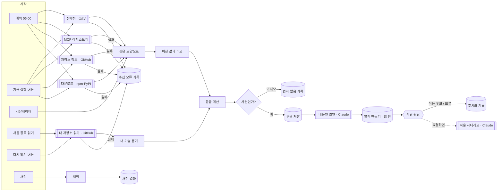

# 흐름 (flow)

> **승인: 2026-11-18 회의**(김영식·차세일·황재웅, 바뀐 것 없음 — 회의 중 팀원이 전달). 이후 바뀌면 "바뀐 기록"에 이유를 적는다.

> 상태: **승인된 설계(2026-11-18 회의), 구현 중.** 흐름 화면(P-6·P-20, PR #32·#46)은 합쳐졌고, 상자마다 기록을 남기는 코드는 조각별로 늘어나는 중이다. 상자와 화살표는 [`flow/flow.json`](../flow/flow.json)에 있다. 흐름 화면(IA-16, 관리자 탭)과 내 실행 기록(IA-11, 사용자는 자기 실행만)은 이 파일의 그림 위에 **실제 실행 기록(`runs`, `run_steps`)**을 칠한다. 미리 그린 불빛은 쓰지 않는다(불변 6).
> 근거: 안내서 2장 "흐름 화면"(필수 8), PRD-F26·F28, `docs/erd.md` `runs`·`run_steps`, `docs/spec.md`

## 1. 한눈에

`[[ ]]`는 바깥 서비스를 부르는 상자(화면에서 작은 표시), `[( )]`는 DB 저장, `{ }`는 분기, `{{ }}`는 사람 판단이다.

**두 길이 있다.**
- ① **카탈로그 수집 길:** 매일 예약 실행 또는 지금 실행 → 바깥 출처 → 같은 모양 → 비교 → 등급 → 사건인가
- ② **내 저장소 길:** 처음 등록하거나 다시 읽기 → 내 저장소 → 내 기술 뽑기 → 등급 → 사건인가(처음 확인한 위험)

두 길은 "등급 계산"에서 만난다. 안내서 그림의 한 줄 흐름에 ②가 더해진 모양이다.

## 2. 상자 목록

| id | 종류 | 이름 | 들어오는 것 | 나가는 것 | 부르는 곳 | 실패하면 |
|---|---|---|---|---|---|---|
| start_schedule | 시작 | 예약 (매일 06:00) | — | 실행 1개(`runs.trigger=schedule`) | — | — |
| start_manual | 시작 | 지금 실행 버튼 | 관리자 클릭 | 실행 1개(`manual`) | — | — |
| start_simulator | 시작 | 시뮬레이터 | 가짜 시나리오 | 가짜 수집 자료(`is_simulated`) | — | — |
| start_first_read | 시작 | 처음 등록 읽기 | 새 프로젝트 | 실행 1개(`first_read`) | — | — |
| start_user_reread | 시작 | 다시 읽기 버튼 | 사용자 클릭 | 실행 1개(`user_reread`) | — | — |
| start_scoring | 시작 | 채점 | 관리자 클릭 | 실행 1개(`scoring`) | — | — |
| fetch_osv | API | 취약점 가져오기 | 두꺼운 기술의 키·버전 | 취약점 목록 | OSV | 그 기술만 수집 오류, 다른 상자는 계속. 정기 실행(P-9d)은 등록된 (기술, 버전)마다 한 번씩 묻고, 한도 초과(429)면 그 실행에서 더 묻지 않으며, 읽은 것보다 실패가 많거나 한도 초과로 멈추면 이 상자가 실패(재시도·3번 연속 강조가 보게) |
| fetch_registry | API | MCP 레지스트리 | 지난번 시각 | 바뀐 서버 목록 | 공식 MCP 레지스트리 | 출처 수집 오류, 3번 연속이면 관리자 강조. 쪽 읽기가 실패하면 이 상자가 실패(앞서 읽은 쪽은 저장되고 읽은 자리가 남아 다음 실행이 이어 읽음). 한 실행에 다 못 읽어도 실패가 아니다(요약에 "이어 읽음") |
| fetch_github | API | 저장소 정보 | 두꺼운 기술의 저장소 | 새 커밋·릴리스·라이선스·별 | GitHub(서버 토큰) | 그 저장소만 수집 오류 |
| fetch_downloads | API | 다운로드 수 | 패키지 이름 | 주간 다운로드 | npm·PyPI | 인기 신호만 비움: 일부 기술이 실패하면 그 기술의 **이전 값을 그대로 두고** `collect_error`에 건수로 센다(불변 2·4). 한쪽 출처(npm 또는 PyPI)가 통째로 실패하면 이 상자가 실패(재시도·3번 연속 강조가 보게). 한도 초과(429)가 나면 그 출처는 그 실행에서 더 부르지 않는다. 404를 0으로 읽지 않는다 |
| fetch_popularity | API | 인기 신호 (3순위) | 기술 목록 | HF·HN·skills.sh 신호 | HF·HN·Firecrawl | 인기 신호만 비움 |
| fetch_repo | API | 내 저장소 읽기 | 공개 저장소 주소 | 파일 내용: **지금 구현은 `package.json`·`.mcp.json` 2종**, 1순위 목표는 `.claude/skills/`를 더한 3종(P-9e, 11-20). `requirements.txt`는 3순위(PRD-F6, SPEC-7.1, ADR 0020) | GitHub | 그 파일의 기술만 수집 오류(불변 2) |
| extract_my_tech | 변환 | 내 기술 뽑기 | 파일 내용 | 기술 키와 버전(SPEC-7) | — | 형식이 이상한 줄은 건너뛰고 이유를 남김 |
| normalize | 변환 | 같은 모양으로 | 출처마다 다른 응답 | 출처·대상·지표·이전 값·현재 값·**바뀐 정도**·시각 | — | 해석 실패 → 수집 오류 |
| compare | 변환 | 이전 값과 비교 | 지금 값 | 바뀐 것만(`observations`) | — | — |
| grade | 변환 | 등급 계산 | 취약점·패턴·저장소 정보 | 등급과 쉬운 이유(SPEC-1·2) | — | 근거가 없으면 "찾지 못함" |
| is_event | 분기 | 사건인가? | 등급·바뀐 값 | 예 / 아니오 건수 | — | — |
| no_change | DB | 변화 없음 기록 | 아니오인 건 | `run_steps` 건수만(처음 읽기·정기 수집은 상자를 단계로 남기지 않아 켜지지 않고 화살표 위 건수로 본다. 관리자 시연 ② "같은 값 두 번"만 단계로 기록해 켠다) | — | — |
| collect_error | DB | 수집 오류 기록 | 실패한 호출 | 오류 종류·내용(비밀값 가림). 정기 수집(`fetch_downloads`·`fetch_osv`·`runBatch`)과 실패 시연은 이 상자를 단계로 기록하고, 처음 읽기(`first-read.ts`)는 건수(화살표)로만 남긴다 | — | — |
| save_change | DB | 변경 저장 | 예인 건 | `changes`(중복 막기 키) | — | 이미 있으면 새로 만들지 않고 그 변경에 잇는다(불변 3). 요약은 건너뛰고 알림 단계로(아직 알림이 없는 사람만, SPEC-3.1). **나간 건수 = 이번 읽기에서 내가 만난 위험 변경 수**(새로 만들었든 이미 있든 같다). 위험이 없는 읽기도 이 단계는 0→0으로 남는다. 새로 만든 수를 적으면 다른 사람이 먼저 읽었다는 사실이 사용자의 실행 기록에 드러나므로(불변 5), **사용자가 시작한 읽기 실행**에는 "새 변경일 때만 하는 단계"(요약)도 기록하지 않는다. 관리자만 읽는 시뮬레이터·정기 실행은 새로 만들었는지 요약 글에 적어도 된다 |
| summarize | API | 대응안 초안 | 변경 하나 | 초안과 출처 | Claude | 알림은 만들고 초안 칸은 "만들지 못함" |
| notify | DB | 알림 만들기 (앱 안) | 변경 + 그 기술을 쓰는 사람 | `alerts`(사람 + 키 하나) | — | 저장 실패면 다음 실행에서 다시. **사용자가 시작한 읽기 실행**은 사용자가 이 기록을 읽을 수 있어(내 실행 기록 탭) 건수를 **시작한 사람 기준**(변경 N건 → 내 새 알림 M건)으로만 남긴다(불변 5). 관리자만 읽는 시뮬레이터·정기 실행은 전체 사람 기준. **위험이 없는 읽기는 변경이 없어 이 단계를 부르지 않고 상자도 켜지지 않는다**(의도한 동작, 2026-11-18) |
| human_judgment | 사람 | 사람 판단 | 알림 | 적용 후보 / 보류 | — | 판단 대기에서 멈춤 |
| action_record | DB | 조치와 기록 | 판단 | `judgments`(한 조치와 결과) + 알림 완료 | — | 둘 다 그대로, "저장하지 못했어요"(불변 4) |
| scenario | API | 적용 시나리오 (참고 자료) | 사용자 요청 | 시나리오 | Claude | "만들지 못했어요"와 다시 요청 |
| score | 변환 | 채점 | 정답 사례 G1–G9, 시뮬레이터 결과 | 맞음·놓침·잘못 울림 수 | — | — |
| score_save | DB | 채점 결과 저장 | 채점 결과 | `runs`, `eval/` 파일 | — | — |

## 3. 화면에 칠하는 규칙

| 무엇 | 규칙 | 기록 칸 |
|---|---|---|
| 상자 색 | 회색 아직 안 켜짐 · 파랑 실행 중 · 초록 성공 · 빨강 실패 · 주황 점선 **판단 대기**. 단계로 남기지 않는 상자(처음 읽기·정기 수집의 `no_change`, 처음 읽기의 `collect_error`)는 실제 실행에서 늘 회색일 수 있다 | `run_steps.status` |
| 시작 노드 | 누른 시작에서 출발한 길만 굵게, 그 시작 상자는 굵은 테두리 | `runs.trigger` |
| 화살표 위 숫자 | 넘어간 건수. 분기는 갈래마다("사건 3 / 변화 없음 9 / 수집 오류 0") | `run_steps.count_in`·`count_out`·`branch_counts` |
| 바깥 서비스 표시 | API 상자 위에 작은 표시(OSV, GitHub, Claude …) | `flow.json`의 `badge` |
| 상자 누르기 | 설정(flow.json의 config) · 들어온 것 · 나간 것 · 호출(주소, 응답 코드, 걸린 시간, 받은 건수) · 오류. **비밀값·개인정보는 가림** | `run_steps` |
| 실행 목록 | 언제, 무엇으로 시작했는지, 성공·실패, 걸린 시간, 처리 건수. 새로고침해도 남음. 줄을 누르면 그 실행의 길과 색으로 바뀜 | `runs` |
| 판단 대기 → 이어가기 | 사람 판단 상자는 주황 점선으로 멈춰 있다가, **판단이 저장되면 같은 실행의 "조치와 기록" 상자가 초록으로 켜진다.** 판단 전에는 조치 상자가 켜지지 않는다 | `run_steps`(사람 판단 · 조치와 기록 줄을 판단 저장 때 고침) |
| 시나리오 | 점선 화살표. 판단 대기 중에도 켜질 수 있다(참고 자료, ADR 0010). 조치 상자와 따로 | `scenarios` |
| 사용자 화면(IA-11) | 자기가 시작한 `first_read`·`user_reread` 실행만, 같은 그림 | RLS |

## 4. 실패를 일부러 보여 주는 법 (시연)

| 시연 | 하는 일 | 보이는 것 |
|---|---|---|
| 수집 오류 | 관리자 화면에서 한 출처 주소를 일부러 틀리게 두고 지금 실행 | 그 API 상자가 빨강, 오류 종류 "상태 코드"·"네트워크", 나머지 상자는 계속 |
| 사건 아님 | 같은 값으로 두 번 실행 | "변화 없음" 갈래 숫자만 늘고 알림 없음 |
| 중복 | 시뮬레이터를 같은 시나리오로 두 번 | 두 번째 실행은 새 변경 없음("변경 저장"이 "이미 있는 변경"), 새 알림 0건이라 알림 상자는 초록, 알림 수 그대로 |
| 판단 대기 | 시뮬레이터로 가짜 취약점 | 사람 판단에서 주황 점선으로 멈춤 → 판단하면 조치와 기록이 켜짐 |
| 저장 실패 | 시연용 스위치로 판단 저장을 실패시킴 | 조치 상자 빨강, 알림은 판단 대기 그대로 |

## 5. 알림 방식

v1 알림은 **앱 안**(알림 목록·지도 띠)만 쓴다. 안내서 그림의 "메일"은 예시이고, 안내서가 요구하는 것은 "종류마다 알림이 간다"이다. 메일·메신저 알림은 안내서가 **알파 예시**로 드는 것이라 필수는 아니다. 외부 발송 규칙(팀 CLAUDE.md 7절)과 테스트 계정 준비가 필요해 **다음 버전**으로 미뤘다(IA-Q7, prd 5-1). 그래서 흐름 그림의 알림 상자는 바깥 서비스 표시가 없는 **DB 저장 상자**다.

## 6. 화면 캡처

흐름 화면(`/admin/flow`)은 구현해 합쳤다(P-6·P-20, PR #32·#46). **캡처는 아직 이 문서에 없다.** 관리자 로그인이 있어야 볼 수 있는 화면이라 사람이 시연 계정으로 열어 찍어 붙인다(안내서 요건, 발표 전).

## 바뀐 기록

- 2026-11-18 초안: 안내서 흐름 그림과 대조해서 씀. 시작 노드 6개(`runs.trigger`와 1:1), 두 길(카탈로그 수집, 내 저장소), 상자 27개, 화살표 36개, 칠하는 규칙, 실패 시연 5가지, 알림이 앱 안인 이유. `run_steps` 건수 칸과 `observations.change_size`를 erd에 추가
- 2026-11-18 개발 전 점검: `save_change → notify` 화살표 추가(화살표 37개). 같은 변경이 이미 있을 때 흐름이 멈추면 두 번째 사용자의 "처음 확인한 위험" 알림이 생기지 않아 SPEC-3.1과 어긋났다. 변경은 하나, 알림은 사람마다 알림 키로 따로 막는다
- 2026-11-18 P-3 실제 DB 시험(I-P-3-notify-step): notify 건수의 기준을 정함. 사용자가 시작한 읽기 실행은 시작한 사람 기준, 시뮬레이터·정기 실행은 전체 사람 기준. 이유: run_steps_select 때문에 사용자가 자기 실행의 단계를 읽을 수 있어, 전체 기준 건수가 남의 사용 규모를 드러냄
- 2026-11-18 흐름 다듬기(`I-P-20-flow-polish`): 화살표 위 건수 꼬리표가 상자와 겹쳐(화살표 37개 중 20개) 상자 사이 간격을 52→100px로 넓히고, 꼬리표를 곡선 위에서 상자와 겹치지 않는 자리에 둔다(`lib/flow/edge-label`). 숫자·색 규칙(3절, 불변 6)은 그대로. 개발용 샘플의 ③ 중복 장면을 4절대로(새 변경 없음, 알림 단계 성공·새 알림 0건) 고침
- 2026-11-18 읽기 실행의 단계 건수 기준(작업 `I-P-3-step-counts`, 사용자 결정): save_change의 나간 건수는 "내가 만난 위험 변경 수", 위험이 없는 읽기는 notify 상자가 안 켜지는 것을 의도한 동작으로 확정. 이유: 새로 만든 수를 적으면 두 번째 사용자의 기록이 1→0이 되어 다른 사람이 먼저 읽었다는 사실이 드러난다(불변 5). 규칙이 없던 "위험 없는 읽기"도 정해 둔다
- 2026-11-18 P-9 첫 조각(작업 `I-P-9-collectors`): `fetch_downloads`가 실제로 돈다. 수집기는 `fetch_downloads`(들어온 건수 없음, 나간 건수 = 읽은 기술 수) 뒤에 `normalize`(읽은 N → N), `compare`(읽은 N → 나가는 건수 **0**: 다운로드의 바뀐 값은 수집 자료로만 남고 등급 계산으로 넘어가지 않아, `compare→grade` 화살표가 OSV 숫자와 섞이지 않게. 바뀐 개수는 요약에)를 남기고, 일부 기술만 실패했으면 `collect_error`(실패한 기술 수)를 남기고, 한쪽 출처가 통째로 실패하면 `fetch_downloads`를 실패로 던진다(그때 `normalize`·`compare`는 읽은 쪽만 남고 `collect_error`는 `runBatch`가 남긴다). 기술마다 마지막 오류는 `signals.downloads_error`. 읽을 기술이 없으면 `fetch_downloads` 0건만 남고 나머지 상자는 회색으로 둔다. `grade`·`is_event`는 다운로드가 사건이 아니라 인기 신호라 지나지 않는다.
- 2026-11-18 정기 OSV 재확인(작업 `I-P-9d-osv-daily`): `fetch_osv`가 정기 실행에서도 돈다. 수집기는 `fetch_osv`(나간 건수 = 확인한 (기술, 버전) 수) 뒤에 `normalize`(N → N), `compare`(N → 등급·근거가 **바뀐** M), `grade`(N → N, 갈래 = 등급별), `is_event`(N 중 갈래 `event` = **이번에 새로 만든 변경 수**·`no_change`·`collect_error`), `save_change`(새 변경 수), 알림이 실제로 만들어졌을 때만 `notify`(들어온 건수 = 알림을 확인한 위험 기술 수, 나간 건수 = 만든 알림 수, 전체 사람 기준)를 남긴다. 이어지는 위험에 알림만 새로 만든 경우는 사건이 아니라 `notify` 건수로만 센다. 일부만 실패하면 `collect_error`를 남기고, 읽은 것보다 실패가 많거나 한도 초과로 멈추면 `fetch_osv`를 실패로 던진다(그때 `collect_error`는 `runBatch`가 남긴다). 다운로드의 `compare`는 나가는 건수를 0으로 두어 `compare→grade` 숫자에 안 섞인다.
- 2026-11-18 문서 점검 2차(작업 `I-doc-fixes-2`): 머리 상태를 "코드 전"에서 "구현 중"으로, `fetch_repo`의 읽는 파일을 지금 구현(2종)과 목표(4종)로 나눠 적음(점검 Y-4 ⑥, ⚪), 6절 화면 캡처는 "화면은 합쳤고 캡처만 없다"로 고침(점검 Y-15). `flow.json`은 안 고침: 처음 읽기 길에서 `fetch_osv`로 가는 화살표(점검 Y-4 ①)는 상자 배치에 영향을 줄 수 있어 주인(차세일)과 함께 정한다
- 2026-11-18 공식 MCP 레지스트리 수집(작업 `I-P-9c-registry`): `fetch_registry`가 정기 실행에서도 돈다. 수집기는 `fetch_registry`(나간 건수 = 읽은 최신 버전 서버 수) 뒤에 `normalize`(N → N), `compare`(N → 나가는 건수 **0**: 레지스트리의 바뀐 값은 등급 계산으로 넘어가지 않아 `compare→grade` 화살표에 OSV 숫자와 섞이지 않게. 새·고침·상태 바뀜·그대로·들이지 않음 개수는 요약에)를 남기고, 모양이 이상해 읽지 못한 항목이 있으면 `collect_error`(그 항목 수)를 남긴다. `grade`·`is_event`는 지나지 않는다(서버 목록은 사건이 아니다). 상태가 바뀐 서버는 수집 자료(status)로 남는다.
- 2026-11-18 2차 점검 결정(Y-8·Y-4 ②·Y-11 ④⑤, ADR 0020, 사용자가 정하고 팀은 PR 리뷰에서 확인)(작업 `I-doc-fixes-3`): `fetch_repo` 읽는 파일의 1순위 목표를 3종(`.claude/skills/` 추가, P-9e)으로, `requirements.txt`를 3순위로 고침(점검 Y-8). `no_change`·`collect_error` 상자가 실제 실행에서 켜지는 경우를 코드 기준으로 적음(점검 Y-4 ②): 코드는 그대로 두기로 정함 — 정기 수집과 실패 시연은 `collect_error`를 단계로 기록해 켜지고, 처음 읽기의 `collect_error`와 처음 읽기·정기 수집의 `no_change`는 건수로만 보이고, 관리자 시연 ②(같은 값 두 번)만 `no_change`를 단계로 켠다. 이유: 오류 시연에 필요한 불빛은 이미 켜지고 건수는 화살표에 실제 기록으로 보이며, 코드 동결 이틀 전에 실행 기록 코드를 건드리지 않는다
