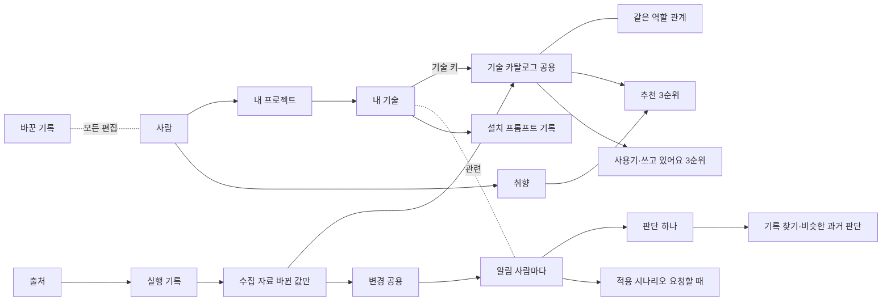

# 데이터설계 (관계와 권한)

> **승인: 2026-11-18 회의**(김영식·차세일·황재웅, 바뀐 것 없음 — 회의 중 팀원이 전달). 이후 바뀌면 "바뀐 기록"에 이유를 적는다.

> **칸·값은 `docs/erd.md`가 정본이다**(2026-11-18). 이 문서와 erd가 다르면 erd를 따른다.
> 처음 상태(11-18 승인 전에 적은 것): **초안, 팀 승인 전.** 데이터설계 인터뷰(2026-11-17, 팀원 1명, DS1·DS3–DS8 + 결정 질문 Q1–Q14 전부 추천대로)를 바탕으로 Claude가 썼다. 테이블 칸의 종류·키는 다음 문서 `docs/erd.md`에서 정한다. 여기서는 **무엇을 저장하고, 서로 어떻게 이어지고, 누가 읽고 고치는지**를 정한다.
> 함께 읽을 것: 8절(카탈로그에 넣는 기준), `docs/prd.md`(요구 PRD-F·NF), ADR 0007(로그인, 개정), ADR 0009(설치 프롬프트·공개 목록), ADR 0008(개발 전에 정한 뿌리 결정), CLAUDE.md 3절 불변 규칙

## 0. 한눈에

## 1. 정한 원칙

| # | 원칙 | 이유 | 출처 |
|---|---|---|---|
| 1 | **기술 카탈로그는 공용** 하나. 사람마다의 "내 기술"은 카탈로그를 가리키는 줄이다. 이름만 직접 추가한 기술은 카탈로그를 가리키지 않고 이름만 저장한다 | 등급·지도 연결을 한 번 계산해 모두에게 쓴다 | DS1 |
| 2 | **기술 신분증(기술 키)**은 생태계와 이름으로 정한다(7절). 이름이 비슷한지로 맞추지 않는다 | 저장소 읽기 → 카탈로그 → OSV 조회 → 중복 막기가 AI 없이 같은 결과로 이어진다. 이전 프로젝트는 이름 맞추기에서 오탐이 많았다 | Q7, ADR 0008 |
| 3 | **"내 기술"은 AI 코딩 도구만**: MCP 서버, 스킬, 플러그인, LLM·에이전트 SDK. 나머지 의존성(react 등)은 v1에서 읽지 않는다 | 일반 의존성까지 넣으면 Dependabot과 같아진다(문제정의 10절 접은 후보) | Q8, ADR 0008 |
| 4 | **사건은 두 층**: 바깥 변화는 **변경** 한 줄(공용), 그 기술을 쓰는 사람마다 **알림** 한 줄 | 같은 변경은 한 번만, 알림은 "사람 + 변경" 쌍 하나만 → 불변 3을 DB 중복 금지로 지킨다 | DS3 |
| 5 | **알림 하나에 판단 하나.** 알림 상태는 판단이 저장된 뒤에만 "완료"가 된다 | 저장 실패 시 판단 대기가 그대로 남는다(불변 4) | DS4 |
| 6 | **적용 시나리오는 요청할 때만** 만든다(판단 전후 언제든). **참고 자료**라 조치가 아니다. 조치는 판단 저장이다(ADR 0010) | 비용 절약, 불변 1과 부딪히지 않음 | Q2 |
| 7 | **지우지 않고 보관**: 프로젝트를 지우면 "보관"으로 숨긴다. 판단 기록은 남는다 | 기록 찾기·비슷한 과거 판단에 계속 쓴다 | DS5 |
| 8 | **바꾼 기록은 한 테이블**에 덧붙이기만: 관리자가 한 일 + 사용자의 기술 목록 편집 | 안내서의 "작성자·시각"과 관리자의 "담당자·시각·사유"를 한 곳에서 | DS6 |
| 9 | **수집 자료는 바뀐 값만** 새 줄로. 실행 기록은 항상 남긴다 | 안내서: 변화 없으면 수집 기록만 남기고 사건은 만들지 않음 | DS8 |
| 10 | **알파는 설치 프롬프트**: 만든 기록(`exports`)만 남기고 프롬프트 자체는 그때 만든다(정해진 틀). 노션 테이블은 다음 버전 설계로 남긴다 | 같은 목록이면 같은 프롬프트, 바깥 글이 섞이지 않음 | ADR 0009 |
| 11 | **이전 프로젝트("tech-radar-agent")의 데이터는 가져오지 않는다.** 로직만 TypeScript로 옮긴다(6절) | 기술 292개의 대부분이 일반 IT 제품이고 설명 1,731건이 모두 미확인, 같은 역할 관계는 3개뿐(2026-11-17 조회) | Q4 |
| 12 | **추천은 알림·판단과 따로**(3순위). 사건이 아니다 | 추천은 바깥 변화가 아님(문제정의 9절). 판단을 요구하는 알림이 늘면 소음 | Q1, 회의 D6 |
| 13 | **카탈로그는 관문 세 개를 거쳐 "얇게 / 두껍게" 두 단계로** 넣는다(8절). 두꺼운 기술만 등급 검사·비교·정기 확인(8절 "보안 검사 주기") | 다 모으면 GitHub 한도와 Claude 비용이 바닥나고 지도가 읽히지 않는다(별 100개 이상만 해도 약 7,000개, 2026-11-17 실측) | C1–C5 |
| 14 | **갈래 나무는 "하는 일" 한 축, 2단계(큰 갈래 > 작은 갈래).** 종류(MCP·스킬…)와 쓰는 곳(Claude Code·Claude 앱…)은 나무가 아니라 기술의 칸 | 세 축을 한 나무에 섞으면 같은 역할의 디자인 스킬과 디자인 MCP가 서로 멀어지고, 여러 곳에서 쓰는 스킬이 나무에 겹친다. 깊을수록 자동 분류가 틀리기 쉽다 | T1, T2 |
| 15 | **같은 역할은 "후보 → 확정" 두 단계**: 같은 작은 갈래면 후보(AI 제안은 근거 인용(설명·README 문장)이 원문에 있을 때만 저장), **확정은 관리자 확인만**(ADR 0015). 알림·두껍게는 확정된 관계만 | AI만으로 만든 관계는 정확도가 눈대중 70–75%였다(이전 프로젝트) | T3 |
| 16 | **처음 읽을 때의 알림**: 새로 들어온 내 기술이 **위험**이면 "처음 확인 → 위험" 변경으로 보안 경고 1번. 주의·통과는 등급만. 적용 기회는 **등록 시각 이후**에 새로 들어오거나 새로 확정된 같은 역할 기술만. 첫 점검 결과는 지도 띠에 요약 한 번 | 위험한 걸 쓰는 중이면 판단이 필요하지만, 기존 대안까지 다 알리면 첫날 알림이 쏟아진다. 중복 막기 키가 같아 다시 읽어도 두 번 생기지 않음 | F1–F3 |
| 17 | **내 기술 목록은 "쓰고 있어요"에 기본 공개**, 설정의 숨김 체크박스로 끔. 서버가 수와 **별명**만 계산해 주고 남의 목록 원본은 내려보내지 않음 | 확장 여지 기능(사용기·쓰고 있어요)을 지금 보여 주되, 사용자가 생긴 뒤에도 끌 수 있게 | ADR 0009, 불변 5 문구는 회의 D11 |
| 18 | **카탈로그 종류에 연동 서비스와 개념**을 더한다(3순위). 개념은 등급·알림이 없는 지도 노드 | AI 도구와 연결할 수 있는 서비스, 하네스 같은 패턴도 지도에서 보이게 | 2026-11-17 범위 결정: 연동 서비스·개념(worklog 55, I-022), ADR 0008 2번 |

## 2. 무엇을 저장하나

칸은 개념 수준이다(이름·종류·키는 `docs/erd.md`). **굵은 칸**은 중복을 막는 기준이다.

### A. 사람

| 테이블(가칭) | 한 줄 | 주요 칸 | 누가 만드나 |
|---|---|---|---|
| `profiles` | 사람 | 로그인 id(Supabase Auth), **역할(user / admin)**, 로그인 방법(**구글**, 노션은 다음 버전, 개발·QA 환경에서만 이메일 테스트 계정), **별명**(가입 때 정함, "쓰고 있어요"에 보이는 이름. 실명 아님), **목록 공개 여부(기본 켜짐)** | 가입할 때 서버 |
| `preferences` | 취향 (3순위) | 사람, 만드는 것, 쓰는 도구, 관심 분야(가입 질문 3개), 건너뜀 여부 | 사람 |

### B. 직접 입력

| 테이블 | 한 줄 | 주요 칸 | 누가 만드나 |
|---|---|---|---|
| `projects` | 내 프로젝트 | 주인, 이름, 종류(저장소 / **프로젝트 밖(내 컴퓨터)**), 공개 저장소 주소, 메모, 작성 시각, 보관 시각 | 사람(프로젝트 밖은 가입 때 서버가 자동) |
| `my_technologies` | 내 기술 목록의 한 줄 | 주인, 프로젝트, **기술 키**(카탈로그) 또는 직접 쓴 이름, 출처(저장소에서 읽음 / 직접 추가 / 내 컴퓨터 목록 가져오기), 쓰는 버전, 숨긴 시각, 어느 파일에서 읽었는지, 마지막으로 읽은 시각, **내 버전의 보안 등급과 이유**(OSV 취약점이 버전마다 달라서 카탈로그와 별도로 둠), 마지막 확인 성공 시각, **수집 오류 표시와 오류 종류** | 저장소 읽기(서버) 또는 사람 |

중복 막기: 한 프로젝트 안에서 **같은 기술 키는 한 줄.** 숨긴 줄은 지우지 않으므로, 다시 읽어도 새 줄이 생기지 않고 숨김이 유지된다.

### C. 기술 카탈로그 (공용)

| 테이블 | 한 줄 | 주요 칸 | 누가 만드나 |
|---|---|---|---|
| `technologies` | 기술 하나 | **기술 키**, 표시 이름, 종류(MCP / 스킬 / 플러그인 / SDK / 모델 / **연동 서비스** / **개념**, 개념은 등급 없음), 작은 갈래와 **그 갈래를 정한 관리자·시각**(관리자가 정했으면 서버 분류가 덮어쓰지 않음, P-18c), **쓰는 곳**(Claude Code / Claude 앱 / Cursor / Codex 등, 여러 개), **상태(활동 중 / 쉬는 중 / 중단 / 출처에서 사라짐)와 바뀐 시각, 연속으로 못 찾은 횟수, 마지막 확인 성공 시각, 수집 오류 종류**(수집 오류는 상태가 아니라 따로 표시), **깊이(얇게 / 두껍게)와 두껍게 된 이유, 인기 순위 밖 연속 일수**(내 기술 / 같은 역할 / 인기 / 공식), 한 줄 설명과 근거 링크, 저장소, 라이선스, 마지막 활동과 **그 종류(릴리스 / 커밋)**, 공식 여부, **인기 신호**(주간 다운로드, 스킬은 skills.sh 설치 수, 별, 7일 증가, HN 점수, HF 점수)와 **갈래 안 점수·순위**, **현재 보안 등급·쉬운 이유·근거 링크·등급 규칙 버전**(두꺼운 기술만) | 수집(서버), 사용자 저장소 읽기에서 처음 본 기술 |
| `categories` | 갈래 나무 ("하는 일", **2단계**) | 이름, 위 갈래(큰 갈래면 없음), 분류 규칙 키워드 | 팀(처음 목록), 관리자 |
| `tech_relations` | 기술끼리의 관계 | 두 기술, 종류(v1은 **같은 역할** 하나), **상태(후보 / 확정)**, 근거 원문 인용, 만든 방법(처음 짝 목록 시드 / 같은 작은 갈래 규칙 / AI 제안 / 관리자), 확정한 사람·시각 | 규칙·AI 제안(서버), 관리자 확인 |

같은 역할 관계는 두 기술을 작은 키 먼저 저장해 한 쌍이 한 줄이다. AI가 제안한 관계는 **근거 인용이 원문에 그대로 있을 때만** 저장하고, 관리자 확인 전에는 "확인 전"(후보)으로 두고, 확정은 관리자 확인만 한다(ADR 0015. 이전 프로젝트에서 AI 관계 정확도가 눈대중 70–75%였다).

### D. 수집

| 테이블 | 한 줄 | 주요 칸 | 누가 만드나 |
|---|---|---|---|
| `sources` | 출처 | 이름, 방법(공개 API / Firecrawl), 간격, 켜짐 여부. v1: **OSV, 공식 MCP 레지스트리, GitHub 저장소 정보, npm·PyPI 다운로드 수, Hugging Face, Hacker News** (+ Firecrawl로 skills.sh 인기 페이지 1곳, 3순위) | 팀 |
| `runs` | 실행 한 번 | 시작 방식(**예약 / 지금 실행 / 시뮬레이터 / 사용자 다시 읽기 / 처음 등록 읽기 / 채점**), 누가 시작, 상태, 시작·끝 시각, 처리 건수, 시도 횟수, 다음 시도 시각 | 서버 |
| `run_steps` | 실행 안의 단계 | 실행, 단계 이름(`flow/flow.json`의 상자), 들어온 것·나간 것 요약, **들어온·나간 건수, 갈래별 건수**(흐름 화면 화살표 숫자), 상태, **오류 종류**(시간 초과 / 네트워크 / 한도 초과 / 상태 코드 / 해석 실패), 오류 내용 | 서버 |
| `observations` | 수집 자료 | 출처, 대상 기술 키, 지표(등급, 최근 활동, 새 버전, 인기 등), **이전 값, 현재 값, 바뀐 정도**, 수집 시각, 실행, 실제 수집 / 시뮬레이터 표시 | 서버 (값이 바뀌었을 때만) |

흐름 화면(IA-16)과 내 실행 기록(IA-11)은 `runs`·`run_steps`만 읽어서 그린다(불변 6).

### E. 사건과 판단

| 테이블 | 한 줄 | 주요 칸 | 누가 만드나 |
|---|---|---|---|
| `changes` | 변경 (공용) | 종류(보안 등급 바뀜 / **처음 확인한 위험** / 같은 역할 새 기술), 기술 키, 버전, 원인, 위험이 된 회차, 이전 값, 현재 값, 출처, 발견 시각, 수집 자료, **중복 막기 키**(규칙은 SPEC-3.1·3.2, 칸은 erd `changes.dedupe_key`), **대응안 초안과 출처(변경마다 1번)**, 시뮬레이터 표시 | 서버 (사건 기준을 넘을 때, 기준은 spec) |
| `alerts` | 알림 (사람마다) | 사람, 변경, 종류(**보안 경고 / 적용 기회**), 관련된 내 기술, 상태(**판단 대기 / 완료**), 비교표(적용 기회), 만든 시각. **사람 + 변경은 한 줄** | 서버 |
| `judgments` | 판단 | 알림(**알림당 하나**), 결과(적용 후보 / 보류), 이유(보류면 필수), **한 조치와 결과**(적용 후보 기록 / 보류 사유 기록), **고친 버전**(보안 경고의 적용 후보일 때, ADR 0012), 누가, 언제 | 사람 (본인 알림에만. 관리자도 본인 알림만) |
| `tech_marks` · `tech_mark_events` | 알림 없는 판단(관심 · 적용 후보 · 보류, ADR 0028)과 그 바뀐 기록 | 사람, 기술, 상태, 이유(보류면 5자 이상), 고친 시각. **사람 + 기술은 한 줄.** 기록은 전 상태 → 새 상태(덧붙이기만) | 사람 (본인 것만, DB 함수 `set_tech_mark`로만. 위험 등급은 적용 후보 안 됨, ADR 0012) |
| `scenarios` | 적용 시나리오 | 알림, 요청한 사람, 상태(만드는 중 / 완료 / 실패), 비교표·적용 단계·위험·되돌리기, 출처, 시각 | 요청하면 서버(Claude) |

"비슷한 과거 판단"(IA-7, UJ-9)은 따로 저장하지 않고, 같은 기술·같은 역할 기술에 대한 내 `judgments`를 찾아 보여 준다.

### F. 추천 (3순위)

| 테이블 | 한 줄 | 주요 칸 | 누가 만드나 |
|---|---|---|---|
| `recommendations` | 추천 한 줄 | 사람, 기술, 추천 이유, 근거 신호와 출처, 만든 시각, 반응(관심 있음 / 없음 / 아직). **사람 + 기술은 한 줄** | 서버 |

### G. 설치 프롬프트 (알파 [D2]) · 노션 (다음 버전)

| 테이블 | 한 줄 | 주요 칸 | 누가 만드나 |
|---|---|---|---|
| `exports` | 내보내기 한 번 | 사람, 종류(설치 프롬프트 / 내 컴퓨터 목록 가져오기 / 노션은 다음 버전), 고른 기술 수, 뺀 위험 수, 가져온 줄 수, 시각 | 서버 (사람이 만들기·저장을 누른 뒤) |

아래 노션 테이블은 **다음 버전** 설계다.

| 테이블 | 한 줄 | 주요 칸 | 누가 만드나 |
|---|---|---|---|
| `notion_connections` | 노션 연결 (사람당 하나) | 사람, 워크스페이스 이름, 고른 페이지, 만든 데이터베이스, **토큰 → Vault 비밀 id**, 연결 시각 | 서버 |
| `notion_exports` | 보내기 한 번 | 사람, 미리보기 수(추가·고침·그대로), 결과 수(성공·실패), 상태, 시각 | 서버 (사람이 확인을 누른 뒤) |
| `notion_rows` | 내 기술 ↔ 노션 행 짝 | 내 기술, 노션 페이지 id, 마지막으로 보낸 값의 해시. **내 기술 하나에 짝 하나** | 서버 |

### I. 확장 여지 (3순위)

| 테이블 | 한 줄 | 주요 칸 | 누가 만드나 |
|---|---|---|---|
| `usage_notes` | 사용기 | 쓴 사람, 기술, 무엇에 썼나, 결과, 한 줄 팁(500자 안), 숨김 여부(관리자), 시각 | 사람 |
| `helpful_votes` | 도움이 됐어요 | 사용기, 누른 사람, 시각. **사용기 + 사람은 한 줄**(한 번만), 자기 글은 못 누름. 나중 기여도 점수의 원재료 | 사람 |
| `reports` | 신고 | 사용기, 신고한 사람, 이유, 처리(관리자·시각·사유) | 사람, 관리자 |
| `news_items` | 소식판 | 출처(공식만), 제목, 링크, 쓰는 곳, 관련 기술 키, 발표 시각 | 서버 |

### H. 바꾼 기록, AI 호출, 위키 챗봇

| 테이블 | 한 줄 | 주요 칸 | 누가 만드나 |
|---|---|---|---|
| `audit_logs` | 바꾼 기록 (덧붙이기만) | 누가, 역할, 무엇을(직접 추가·숨김·되돌리기·지금 실행·분류 고치기·역할 바꾸기 등), 대상, 사유, 시각 | 서버 |
| `ai_calls` | Claude API 호출 기록 | 쓰는 곳(대응안 / 시나리오 / 분류 제안 / 챗봇), **입력 해시(같은 입력은 다시 보내지 않음)**, 토큰 수, 상태, 오류, 시각 | 서버 |
| `chat_logs` | 위키 챗봇 기록 | 누가, 질문, 찾은 위키 쪽, 답, 시각 | 서버 |

`ai_calls`로 하루 호출 한도와 연속 실패 시 쉬어 가기를 건다(이전 프로젝트의 방식). 챗봇의 하루 20개 한도는 `chat_logs`를 세서 건다.

### 채점

시뮬레이터 시나리오와 정답 사건 목록은 저장소의 파일로 둔다(`sim/`). 채점 결과는 `runs`(시작 방식 = 채점)와 결과 파일에 남긴다.

## 3. 어떻게 이어지나 (한 사람의 하루 기준)

| 여정 | 데이터가 지나는 길 |
|---|---|
| UJ-A3–A5 등록·목록 | `projects` → 저장소 읽기 `runs` → `my_technologies`(기술 키로 `technologies`에 연결, 없으면 카탈로그에 새로) → 직접 추가·숨김은 `audit_logs`에도 |
| 정기 수집 | `sources` → `runs`·`run_steps` → 값이 바뀌면 `observations` → `technologies`의 현재 값 갱신 → 사건 기준을 넘으면 `changes` |
| UJ-1–UJ-3 알림 | `changes` → 그 기술을 가진 사람마다 `alerts`(관련 `my_technologies` 연결). 처음 읽기에서는 위험만 "처음 확인한 위험" 변경, 적용 기회는 등록 시각 이후 것만(원칙 16) |
| UJ-5·6 판단 | `judgments` 저장 성공 → 같은 거래 안에서 `alerts.상태 = 완료`. 실패하면 둘 다 그대로 |
| 시나리오 요청 | `scenarios`(만드는 중) → Claude 호출 `ai_calls` → 완료 또는 실패 |
| UJ-8·9 기록 | `judgments` + `alerts` + `changes`를 읽어 기록 찾기, 같은 기술·같은 역할의 지난 판단 |
| 추천 (3순위) | `preferences` + `technologies`의 인기 신호·갈래 → `recommendations` |
| UJ-B1 설치 프롬프트 | `my_technologies`(숨김 제외, 위험한 버전은 어떤 경우에도 제외) → 정해진 틀로 프롬프트 → 복사, `exports`에 기록. UJ-A5 가져오기는 붙여 넣은 목록 → 미리보기 → `my_technologies`(프로젝트 밖) + `audit_logs` |
| UJ-M1–M3 관리자 | `runs`·`run_steps`의 수집 오류 → 지금 실행(`runs`, `audit_logs`) → 흐름 화면 |

## 4. 누가 읽고 고치나

**역할:** 사람(user) · 관리자(admin, 팀원) · 서버(서비스 키, 정기 실행·Claude 호출). 모든 테이블에 RLS를 켜고, 아래에 없는 것은 막는다(불변 5).

| 테이블 | 사람 (본인) | 관리자 | 서버 |
|---|---|---|---|
| `profiles` | 본인 읽기, **별명**·**목록 공개 여부** 고치기. **역할은 못 바꿈** | 전체 읽기. 역할은 팀이 DB에서 직접(화면 없음) | 가입 때 만들기 |
| `preferences` | 본인 읽기·쓰기 | **못 봄**(취향은 개인 정보. 필요하면 합계만) | 읽기(추천 만들기) |
| `projects` | 본인 읽기·만들기·고치기·보관 | 전체 읽기(IA-12) | 프로젝트 밖 칸 만들기 |
| `my_technologies` | 본인 읽기, 직접 추가·숨김·되돌리기 | 전체 읽기, **고치기 못함** | 저장소 읽기 결과 쓰기 |
| `technologies`, `categories`, `tech_relations` | 모두 읽기 | 읽기, 갈래·관계 확인·고치기(`audit_logs` 남김). technologies는 갈래 세 칸만, 작은 갈래로만(P-18c) | 쓰기 |
| `sources` | 못 봄 | 읽기·켜고 끄기 | 읽기 |
| `runs`, `run_steps` | **본인이 시작한 다시 읽기·처음 읽기만** 읽기(IA-11) | 전체 읽기, 지금 실행 | 쓰기 |
| `observations`, `changes` | 본인 알림에 붙은 것만 읽기 | 전체 읽기 | 쓰기 |
| `alerts` | 본인 읽기. **상태는 판단 저장으로만 바뀜** | 전체 읽기(IA-14). 고치기 못함 | 만들기 |
| `judgments` | **본인 알림에만 만들기**, 본인 읽기 | 읽기만. **남의 알림에는 만들기 못함**(불변 1). 본인 알림은 사용자와 같게(ADR 0016) | 못 만듦 |
| `scenarios` | 본인 알림에 요청·읽기 | 읽기 | 쓰기(Claude 결과) |
| `recommendations` | 본인 읽기, 반응 고치기 | 못 봄 | 만들기 |
| `exports` | 본인 읽기 | 읽기 | 쓰기 |
| "쓰고 있어요" 집계 (서버 함수) | 공개한 사람의 수·별명만 받음. 남의 `my_technologies` 원본은 못 읽음 | 같음 | 계산 |
| `usage_notes` | 모두 읽기(숨김 제외), 본인 글 쓰기·고치기 | 숨김 처리(사유 남김) | — |
| `helpful_votes` | 본인 줄 만들기·지우기, 수는 모두 읽기 | 읽기 | — |
| `reports` | 본인 신고 만들기 | 읽기·처리 | — |
| `news_items` | 모두 읽기 | 읽기 | 쓰기 |
| (다음 버전) `notion_connections` | 연결 상태(페이지·마지막 보낸 시각)만 읽기. **토큰은 아무도 못 읽음** | 못 봄 | 쓰기, Vault에서 토큰 꺼내기 |
| (다음 버전) `notion_exports`, `notion_rows` | 본인 읽기 | 못 봄 | 쓰기 |
| `audit_logs` | 본인 줄 읽기 | 전체 읽기 | 쓰기만. **아무도 고치거나 지우지 못함** |
| `ai_calls` | 못 봄 | 읽기 | 쓰기 |
| `chat_logs` | 못 봄 | 읽기·질문(위키 챗봇은 관리자 = 팀원만) | 쓰기 |

## 5. 불변 규칙이 데이터에서 지켜지는 곳

| 불변 규칙 | 데이터에서 |
|---|---|
| 1 판단 전에 아무것도 실행 안 함, 관리자도 못 건너뜀 | `judgments`는 본인 알림에만 만들 수 있음. (다음 버전: 노션 보내기는 사람의 확인 뒤에만 `notion_exports`.) 관리자도 남의 알림에는 `judgments`를 만들 수 없음(본인 알림은 가능, ADR 0016) |
| 2 수집 실패는 "수집 오류" | `run_steps.오류 종류`, `my_technologies.수집 오류 표시`. 실패한 실행은 `observations`를 만들지 않아 "변화 없음"으로 보이지 않음 |
| 3 같은 변경은 한 번만 | `changes` 중복 막기 키, `alerts`의 사람 + 변경 하나, (다음 버전 `notion_rows`의 내 기술 하나), `my_technologies`의 프로젝트 + 기술 키 하나 |
| 4 거절·저장 실패 시 기존 값 보존 | `judgments` 저장과 `alerts` 상태 변경을 한 거래로. 시나리오·(다음 버전) 노션 보내기는 실패 상태를 따로 남기고 "완료"로 표시하지 않음 |
| 5 권한은 화면·서버·DB에서 | 4절 표를 RLS로. 서버 키는 서버에만 |
| 6 흐름 화면은 실제 기록에서 | `runs`·`run_steps`만 읽음 |

## 6. 이전 프로젝트에서 옮기는 것

이전 개인 프로토타입(`C:\TechRadarAgent`, 파이썬)의 코드를 조사 도우미가 읽기만 해서 보고했다(`docs/agents.md` 2026-11-17). **데이터는 가져오지 않는다.**

| 옮길 로직 (TypeScript로 다시 씀) | 우리 쪽 쓰임 |
|---|---|
| URL 정리(`normalize_url`)와 내용 해시(`content_hash`) | `changes` 중복 막기 키 |
| HTTP 오류 분류(시간 초과·네트워크·한도 초과·상태 코드·해석 실패), 요청 사이 간격, 응답 크기 제한 | `run_steps.오류 종류` = 수집 오류 종류 |
| 실행 단위 재시도(2분·4분 뒤, 총 3번 시도), 멈춘 작업 회수 | `runs.시도 횟수·다음 시도 시각` |
| 프롬프트 주입 막기: 자료를 표시로 감싸기, 답을 스키마로 다시 검사, 도구 안 넘김 | 대응안·시나리오·분류 제안·챗봇 |
| 같은 입력은 다시 보내지 않는 캐시, 하루 호출 한도, 연속 실패 시 쉬어 가기 | `ai_calls` |
| 관계에 원문 인용 요구, 설치 명령 인용은 버림 | `tech_relations` AI 제안 |
| 설명 칸과 근거 연결(한 줄 설명만) | `technologies.한 줄 설명과 근거 링크` |

**옮기지 않는 것:** Gemini 호출, 이전 웹 화면, RSS 수집, 이름 비슷한 것 찾기(fuzzy matching), 관계 9종류, 기술·설명·관계 데이터.

## 7. 기술 키와 "내 기술"을 읽는 규칙

| 어디서 보나 | 기술 키 예 | 내 기술로 넣는 기준 (v1) |
|---|---|---|
| `package.json` | `npm:@modelcontextprotocol/server-filesystem` | MCP 서버·LLM·에이전트 SDK로 알려진 패키지만(목록은 spec) |
| `requirements.txt` (3순위, ADR 0020) | `pypi:anthropic` | 위와 같음 |
| `.mcp.json` | `npm:…` / `pypi:…` / 원격 주소(`url`)면 `url:<호스트>` / 위에 해당 없으면 **키 없음, 서버 별명만**(별명은 사용자가 붙인 이름이라 키로 쓰지 않음, SPEC-7.3) | 모두. 키가 없는 것은 등급 "찾지 못함" |
| `.claude/skills/<이름>/` | `skill:<owner>/<repo>/<이름>` | 모두 |
| `CLAUDE.md` | (설정 파일, 기술 아님) | 언급된 도구는 v1에서 읽지 않음 |
| 수집: GitHub 저장소 | `github:<owner>/<repo>` | — |
| 수집: 공식 MCP 레지스트리 | 패키지가 있으면 그 패키지 키(`npm:…`·`pypi:…`), 없으면(원격 주소만·mcpb 등) `mcp:<레지스트리 이름>` (ADR 0019) | — |
| 수집: Hugging Face | `hf:<id>` | — |
| (3순위) `.cursor/mcp.json`, `AGENTS.md`, `GEMINI.md` 등 다른 AI 도구 설정 | `.mcp.json`과 같은 규칙(`npm:…` / `pypi:…` / `url:…`, 해당 없으면 키 없음·서버 별명만) 등 | 모두. "쓰는 곳" 칸에 Cursor·Codex·Gemini 등 |
| (3순위) SDK·설정 파일로 감지한 연동 서비스 | `service:<이름>` | 공식 MCP·커넥터가 있으면 "AI 도구와 연결 가능" |
| 직접 추가(이름만) | 키 없음, 이름만 | 등급 "찾지 못함", 지도는 관리자 분류 확인 뒤 |

한 기술이 패키지와 저장소를 둘 다 가지면 패키지 키를 신분증으로 쓰고 저장소는 칸으로 둔다.

## 8. 카탈로그에 넣는 기준 (관문 셋, 얇게 / 두껍게)

전부 불러오지 않는다. 기술마다 **카탈로그에 넣을지**와 **얼마나 깊게 모을지**를 아래 관문으로 정한다.

### 관문 1: 우리 분야인가? → 통과하면 **얇게** 한 줄

| 들어오는 곳 | 넣는 기준 | 빼는 것 |
|---|---|---|
| 공식 MCP 레지스트리 | 모든 서버(최신 버전만). 이미 줄이 있는 서버의 중단·삭제는 상태로 반영 | 사용 중단·삭제 표시로 **처음 보는** 서버(들이지 않음) |
| 사용자 저장소 `.mcp.json`, `.claude/skills/` | 모두 | — |
| 사용자 저장소 `package.json`, `requirements.txt`(3순위, ADR 0020) | **허용 목록**에 있는 패키지만(LLM SDK, `@modelcontextprotocol/*`, 에이전트 프레임워크) | 일반 의존성 |
| GitHub (ADR 0020에서 3순위였다가 **11-21 앞당김**, ADR 0030) | **주제 태그 목록**(`mcp-server`, `mcp`, `agent-skills`, `claude-skills`)에 맞고 **별 ≥ 1,000**인 저장소. 두껍게 들이는 것은 아래 "별 후보"의 관문·점수를 통과한 상위만. `claude-code` 태그는 앱·가이드가 섞여 이번에는 뺌 | 태그 없는 저장소, 보관·포크·12개월 무푸시, 의심 표시가 붙은 것(두껍게 안 함) |
| Hugging Face | 코딩에 쓰는 작업 종류의 모델 | 이미지·음성 등 다른 작업 |
| Hacker News (**11-21 구현**, ADR 0030) | **키워드 목록**에 맞고 GitHub 저장소나 패키지로 이어지는 글. 알려진 기술에는 신호만 붙이고, 모르는 저장소는 이름에 mcp·skill이 맞을 때만 **얇게** | 이어지는 기술이 없는 의견·뉴스 |

얇은 줄에는 기술 키, 이름, 출처가 준 한 줄 설명, 출처 링크만 담는다. 등급 검사와 정기 확인은 하지 않는다. 허용 목록·태그 목록·키워드 목록은 spec에서 처음 목록을 만들고, **관리자 분류 확인(IA-17)에서 더하거나 뺀다**(`audit_logs`에 남음).

### 관문 2: 누군가와 관련 있나? → 하나라도 맞으면 **두껍게**

| 두꺼워지는 이유 | 기준 | 인기와 상관 |
|---|---|---|
| 쓰는 사람이 있음 | **사용자 중 한 명 이상**이 내 기술 목록에 두고 있다(숨김 제외) | **상관없이 늘 추적**. 별 3개짜리 스킬도 보안 때문에 |
| 같은 역할 | 사용자 중 한 명 이상이 쓰는 기술과 같은 역할 관계가 있다(확인된 관계) | 상관없이 추적 |
| 공식 | 공식 조직(anthropics, modelcontextprotocol, openai 등)이 냈다: 서버 이름의 이름공간(`/` 앞쪽 전체, `io.github.openai`·`com.openai` 꼴)이 `rule_lists`의 `official_org` 목록의 값과 **전체가 같음**(조직 낱말만 맞으면 아님: `dev.openai`도 통과해 버린다. 게시자가 적는 저장소 주소도 증거가 아님). **공식 MCP 레지스트리에 등재된 것만으로는 아니다**(레지스트리 항목은 모두 등재돼 있다, ADR 0019) | 바로 통과 |
| 인기 (**11-21 바뀜, ADR 0030**) | **별 후보 점수 상위 100곳**(주제 태그 안 백분위, 아래 "별 후보"). 갈래 안 점수 상위 20개는 갈래 목록과 재료(skills.sh·HF·다운로드)가 생긴 뒤 P-21 본 계산에서 | — |

- **갈래 안 점수(P-21 본 계산)** = 사용량(주간 다운로드, 스킬은 skills.sh 설치 수), 성장(별·다운로드 7일 증가, HF 인기 점수), 화제(HN 점수), 별 누적의 **같은 갈래 안 순위 평균.** 별 하나로 자르지 않는다. 규모가 작은 갈래(스킬)도 자기 갈래 안에서 경쟁한다. 갈래 목록이 아직 없어서 **지금은 아래 "별 후보"가 임시로 인기 경로를 맡는다.**
- **12개월 넘게 활동이 없으면 인기에서 뺀다.** 내 기술·같은 역할이면 계속 추적한다.
- 20개와 12개월은 팀 추정이다. 첫 수집 뒤 실제로 몇 개가 들어오는지 세어 spec에서 고친다.
- 이유가 모두 사라지면(아무도 안 쓰고 순위 밖) 다시 **얇게** 돌아가고 정기 확인을 멈춘다. 지난 수집 자료와 판단 기록은 남는다.

#### 별 후보 (2026-11-21, ADR 0030): 별 개수 하나가 아니라 관문 → 의심 거르기 → 점수
별은 누적이라 오래된 것이 유리하고 사용량이 아니며, 가짜로 부풀릴 수도 있다(11-21에 지난 7일 새 `mcp-server` 저장소 상위에서 같은 이름 복제본이 낯선 계정 5곳에 별 472~474개로 줄지어 있었다. 열어서 확인하지는 않았다). 그래서 별을 "한번 볼 만하다"는 신호로 쓰되 아래 순서로 쓴다. 숫자는 모두 **팀 추정**이고 첫 수집 뒤 세어 고친다.
1. **후보 풀:** 위 표의 GitHub 주제 태그 4개, 별 ≥ 1,000. 검색 결과 한 건에 별·포크·푸시·생성일·소유자 종류·라이선스·보관·설명이 같이 와서 저장소마다 따로 부르지 않는다(검색 한 번에 1,000건이 한계라 넘으면 별 구간으로 쪼갠다). 종류는 태그로 임시 추정한다(`mcp-server`·`mcp` → mcp, `agent-skills`·`claude-skills` → skill).
2. **관문(모두 통과):** 보관 아님 · 마지막 푸시 12개월 이내 · 포크 저장소 아님 · 의심 표시 없음.
3. **의심 표시:** ① 생성 30일 미만인데 별 ≥ 500 → `new_spike`(풀 하한이 별 1,000이라 별 조건은 늘 맞고 실제로는 "생성 30일 미만"이 기준이다. 하한을 낮추면 500이 일한다) ② 같은 저장소 이름이 다른 소유자 2곳 이상이고 별 차이 ≤ 5% → `clone_cluster`(**다른 관문을 통과한 저장소끼리만 묶는다. 묶음에 "알려진" 저장소가 있으면 그중 생성일이 가장 이른 하나를 원본으로 보고 표시하지 않고, 알려진 것이 없으면 묶음 전체를 표시해 관리자가 확인한다. 알려진 저장소 = 공식 조직(`is_official`) 줄이거나, 레지스트리 이름이 `io.github.<소유자>/…`이고 <소유자>가 저장소 소유자와 같은 줄**(레지스트리는 이 이름공간을 GitHub 소유자 인증으로 막는다. 게시자가 적는 저장소 주소만으로는 알려진 것이 아니다. npm·PyPI·스킬 줄과 다른 이름공간도 알려진 것으로 치지 않는다. 한계: `io.github.<소유자>`는 계정 주인임을 보일 뿐 원본임을 증명하지는 않아서, 복제본 계정이 자기 이름공간으로 올리면 그 복제본도 알려진 것이 되고, 그래도 진짜 원본이 알려져 있으면 더 이른 생성일이 이긴다. 11-21 2차 보안 검토) 11-21 코드·보안 검토: 보관·오래된 복제본이 진짜 기술의 알림을 막지 못하게 하되, 오래된 저장소 이름을 바꿔 "가장 이른 것"이 되는 우회로 공격자 저장소가 원본이 되지 못하게. 우리 수집기가 전에 만든 `github:` 줄도 알려진 것으로 치지 않는다). 의심이 붙으면 두껍게도 적용 기회 알림에도 쓰지 않고 "NEW 후보(얇게, 관리자 확인)"로만 둔다. 표시는 "확인 필요"이지 증명이 아니다.
4. **점수:** 같은 태그 안 백분위 평균. 규모(별) 30 · 성장(별÷나이일, 나이는 최소 30일) 25 · 사용 증거(포크) 15 · 활동(푸시 최근성) 15 · 신뢰 15(조직 소유 · 라이선스 있음 · 공식 레지스트리 줄과 합쳐짐). 나중에 npm·PyPI 다운로드와 우리 쪽 7일 별 증가를 더한다.
5. **두껍게:** 점수 상위 **최대 100곳**. 이유 `thick_reasons`에 `stars`, `signals.stars`·`candidate_score`·`candidate_flags`를 저장한다. **별 이유로 두꺼워진 줄 누적 상한은 150곳**(닿으면 더 올리지 않고 실행 요약에 적는다). 이번 구현은 "들어오기"만 하고, 순위 밖으로 나가는 완충은 아래 "순위 완충"을 별 후보에 맞춰 첫 수집 뒤에 만든다.
6. **같은 기술 합치기:** 새 줄은 `github:<소유자>/<저장소>` 키. 이미 같은 저장소(`repo_url`, 대소문자·`.git`·끝 `/` 무시)를 가진 줄(공식 레지스트리·사용자가 만든 줄)이 있으면 새 줄을 만들지 않고 그 줄을 두껍게·신호만 갱신한다(패키지 키가 신분증이고 저장소는 칸이라는 7절 규칙).
7. **읽는 값이 바뀐 것만** 수집 자료(`observations`, 지표 `stars`)로 남기고, 못 읽으면 "후보 없음"으로 단정하지 않고 수집 오류로 기록한다(불변 2·3).

Hacker News 글의 점수·댓글은 **화제 신호**(`signals.hn`)로만 붙이고 이번에는 점수 계산에 넣지 않는다. 글에 근거 링크가 없으면 저장하지 않는다(관문 3).

두꺼운 기술에 모으는 것: 보안 등급 근거(OSV, 위험 패턴 검사, 최근 활동·라이선스), 인기 신호, 출처 붙은 한 줄 설명, 같은 역할 관계(원문 인용 필수). **모으지 않는 것:** 커뮤니티 댓글·평판 요약(ADR 0003), README 본문 전체(필요한 줄만 읽고 버림), 가격.

### 나가는 기준: 언제까지 남나

**카탈로그 줄은 지우지 않는다**(판단·알림·변경이 가리키므로). 상태만 바꾼다.

| 상태 | 언제 | 보이는 모습 |
|---|---|---|
| 활동 중 | 기본 | 보통 |
| 쉬는 중 | 12개월 넘게 커밋·릴리스 없음 | 흐리게 |
| 중단 | 출처가 직접 사용 중단이라고 함(MCP 레지스트리 중단, npm deprecated, 저장소 보관 처리) | 회색 + "중단" |
| 출처에서 사라짐 | **성공한 읽기에서 2번 연속** 찾을 수 없음(예: 저장소 404) | 회색 + "출처에서 사라짐" |
| (상태가 아님) 수집 오류 | 읽기 자체가 실패 | 위 상태는 그대로 두고 "수집 오류"를 따로 표시. 사라짐으로 단정하지 않음(불변 2) |

- **상태를 정한 출처(`technologies.status_by`, ADR 0021):** 상태는 여러 출처가 정한다(공식 MCP 레지스트리 = 중단·삭제, GitHub 저장소 정보 = 보관 → 중단·12개월 무활동 → 쉬는 중·404 두 번 → 사라짐). 정한 수집기가 `<출처>:<그때의 상태>`(예 `github:dormant`)로 적는다. **GitHub 수집기는 활동 중인 기술과 자기가 정한 상태(적힌 출처·상태가 지금 상태와 같음)만 올리거나 되돌린다.** 레지스트리·관리자·모르는 출처(적힌 것이 없거나 지금 상태와 다름)가 정한 중단·쉬는 중·사라짐은 올리지도 되돌리지도 않는다: 되돌리면 그 출처의 값이 지워진다. 활동 중으로 돌아가면 `status_by`를 비우고, 활동 중인 줄에 남은 낡은 표시(다른 쪽이 status만 active로 고침)도 읽을 때 비운다.
- **GitHub 저장소 정보로 정하는 값:** 마지막 활동 = 저장소의 마지막 푸시(종류 `commit`, 이미 적힌 시각보다 새로울 때만(같으면 그대로), 읽는 저장소가 바뀐 줄은 읽은 푸시로 바꿈, 다른 브랜치·봇 푸시도 올리는 근사이고 릴리스는 다음 조각. 상태는 줄에 적힌 활동과 읽은 푸시 중 더 새로운 것으로 정함), 라이선스 = SPDX 이름(없으면 `none`, 파일은 있는데 못 알아보면 `other`), 별은 `signals.stars`. 두꺼운 기술에서 `github:<소유자>/<저장소>` 키이거나 `repo_url`이 GitHub 주소인 것을 **저장소마다 1번**(같은 저장소를 가리키는 기술은 한 번 읽어 모두에 적용) 읽는다. **"출처에서 사라짐"은 지금 읽는 저장소를 한 번이라도 찾은 적이 있고(주소를 고쳐 다른 저장소를 가리키게 된 줄은 새 저장소를 찾아야 함), 성공한 읽기에서 404가 2번 연속이며, 첫 404에서 12시간이 지났을 때만** 정한다(잘못 적은 주소나 "지금 한 번 실행"을 두 번 누른 것으로 사라지지 않게). 비공개 저장소는 공용 카탈로그에 정보를 넣지 않고 "못 찾음"으로 본다. 한 번도 찾은 적 없는 저장소(잘못 적은 주소·비공개)는 정보를 읽은 적이 없으므로 "정보를 마지막으로 확인한 시각"을 올리지 않는다. `repo_url`은 레지스트리·사용자가 적은 값이라 검증되지 않았다(다른 저장소의 별·라이선스가 붙을 수 있음).

지도에 보이는지는 보는 사람마다 다르다.

| 자리 | 언제까지 |
|---|---|
| 내 기술(가운데) | 내가 숨기거나 프로젝트를 보관할 때까지. **상태와 상관없이** 남는다 |
| 같은 역할 이웃 | 내 기술이 남아 있고 관계가 "확정"인 동안 |
| 전체 갈래 지도 | 두꺼운 기술 중 공식이거나 인기 상위 20개인 동안 |
| 얇은 기술 | 지도에 안 보임. 직접 추가할 때 검색에서만 |

- **순위 완충:** 인기 상위 20개는 **들어올 땐 바로, 나갈 땐 30위 밖 14일 연속**일 때 빠진다(지도가 날마다 깜빡이지 않게). 빠지면 얇게 돌아가고 정기 확인을 멈춘다. 지난 수집 자료와 판단 기록은 남는다. (갈래 안 점수 경로 기준이다. 별 후보는 11-21에 "들어오기 + 누적 상한 150"만 만들고, 나가는 완충은 첫 수집 뒤 같은 모양으로 만든다. ADR 0030)
- **중단·출처에서 사라짐은 보안 등급 "주의" 근거**로 넣는다. 내 기술의 등급이 바뀌면 지금 규칙대로 보안 경고가 생긴다(규칙은 spec).
- 20·30·14일·2번은 팀 추정이다. spec에서 고친다.

### 보안 검사 주기 (두꺼운 기술)

비싼 일을 매일 다 하지 않고, 바뀐 것이 있을 때만 다음 단계로 간다.

| 단계 | 언제 | 무엇 | 바뀐 게 없으면 |
|---|---|---|---|
| 1 | **매일** | OSV 취약점 묶음 조회 + 새 버전·커밋 확인(GitHub 저장소마다 1번) | 여기서 끝 |
| 2 | **새 버전·커밋이 생겼을 때만** + 안전망으로 **주 1회** | 위험 패턴 검사(스킬·MCP 코드 읽기) | — |
| 3 | 1·2단계 결과가 바뀌었을 때만 | 등급 다시 계산(코드 규칙, **Claude 호출 없음**) | 등급 그대로 |

호출 수와 비용은 추정이다. 첫 수집 뒤 실제로 재서 spec에서 고친다. (2026-11-17, 갈라진 세션에서 사용자 승인)

### 관문 3: 근거가 있나?

출처 링크가 없는 정보는 저장하지 않고 "찾지 못함"으로 둔다. AI가 만든 설명을 근거 없이 쌓지 않는다.

### 별만 쓰지 않는 이유 (2026-11-17 실측)

GitHub 검색 API로 센 저장소 수(태그끼리 겹침이 있어 합은 실제보다 큼): `mcp-server` 별 100+ 1,497 / 1,000+ 289, `claude-code` 3,573 / 779, `agent-skills` 1,305 / 340, `claude-skills` 570 / 147. 별 100으로 자르면 약 7,000개, 1,000이어도 1,500개 안팎이다. 별은 누적이라 오래된 것이 유리하고, 사용량이 아니며, 갈래마다 규모가 달라 숫자 하나로 공평하게 자를 수 없다. 사용량은 npm·PyPI 다운로드 API로 키 없이 잴 수 있다(오늘 확인).

## 9. 열린 질문

| # | 질문 | 언제 |
|---|---|---|
| DQ1 | ~~판단을 나중에 바꿀 수 있게 할지~~ → v1은 "알림당 하나, 고치지 못함"(spec SQ1과 같음. DB 구현이 이미 그렇다: 고치기는 막고, 지우기는 시뮬레이터 가짜 줄만 예외) | 구현 기준으로 닫음 11-18(팀은 이 PR 리뷰에서 확인) |
| DQ2 | 허용 목록·GitHub 태그 목록·HN 키워드 목록·갈래의 처음 목록, 상위 20개·12개월 숫자 확인 | spec, 첫 수집 뒤 |
| DQ3 | 보안 등급 규칙(OSV + 위험 패턴 검사 + 저장소 정보)과 사건 기준 숫자 | spec |
| DQ4 | 수집 자료·AI 호출 기록을 얼마나 오래 둘지 | spec |
| DQ5 | ~~Vercel 정기 실행 횟수와 함수 실행 시간 한도~~ → Hobby 정기 실행은 하루 1번까지, 시각은 지정 시각부터 59분 안 어디서든(https://vercel.com/docs/cron-jobs/usage-and-pricing). 함수 최대 300초(Fluid compute를 켠 경우, https://vercel.com/docs/functions/limitations) | 확인 11-18 |

## 바뀐 기록

- 2026-11-18 안내서 흐름 그림과 대조: `run_steps`에 건수(들어온·나간·갈래별), `observations`에 바뀐 정도
- 2026-11-17 반영 대기 목록 한꺼번에: 원칙 10(설치 프롬프트)·17(기본 공개 + 숨김)·18(연동 서비스·개념), `profiles` 구글·공개 여부, `technologies` 종류·업데이트 종류, `exports`, 확장 여지 테이블(I절), 권한 표, 다른 도구 설정 파일(7절). 노션 테이블은 다음 버전
- 2026-11-17 보안 검사 주기와 표현: 두꺼운 기술은 매일 OSV·새 버전 확인 → 바뀌었을 때(+주 1회) 위험 패턴 검사 → 바뀌었을 때만 등급 재계산. "누군가의 내 기술"을 "사용자 중 한 명 이상이 쓰는 기술"로
- 2026-11-17 로그인·Firecrawl(G1–G3): `profiles` 로그인 방법은 노션·구글(이메일은 개발·QA만), 스킬 사용량은 skills.sh 설치 수(Firecrawl, 3순위)
- 2026-11-17 첫 등록 규칙(F1–F3 전부 추천대로): 원칙 16, 변경 종류 "처음 확인한 위험"
- 2026-11-17 유지 기간 인터뷰(L1–L4 전부 추천대로): 카탈로그 줄은 지우지 않고 상태 5개, 출처에서 사라짐은 성공한 읽기 2번 연속, 인기 순위 완충(들어올 땐 바로, 나갈 땐 30위 밖 14일), 내 기술은 상태와 상관없이 남고 중단·사라짐은 "주의" 근거
- 2026-11-17 갈래 인터뷰(T1–T3 전부 추천대로): 나무는 "하는 일" 한 축·2단계, 종류·쓰는 곳은 칸, 같은 역할은 후보 → 확정. **문제정의 2절("깊이 제한 없는 분류 나무")과 다름** → 이유: 깊을수록 자동 분류가 틀리고 관리자 확인이 늘어 6일 안에 감당하기 어려움. 깊이 제한 없음은 다음 버전(ADR 0008 9번)
- 2026-11-17 수집 기준 인터뷰(C1–C5 전부 추천대로): 관문 셋과 얇게/두껍게(8절), 인기는 갈래 안 순위·상위 20개, 공식은 바로 통과, 12개월 활동 없으면 인기에서 뺌, 출처에 npm·PyPI 다운로드 수 추가, `technologies` 칸 추가
- 2026-11-17 초안: 데이터설계 인터뷰 DS1·DS3–DS8, 결정 질문 Q1–Q14 전부 추천대로(팀원 1명). 공용 카탈로그 + 기술 키, 변경·알림 두 층, 판단 하나, 요청형 시나리오, 보관, 바꾼 기록 하나, 바뀐 값만, 노션 테이블, 추천(3순위), 권한 표, 불변 규칙 대응, 이전 프로젝트에서 옮길 로직. 팀 승인 전
- 2026-11-18 개발 전 점검 반영(I-028): "칸·값은 erd가 정본" 한 줄(runs 시작 방식·출처 값·중복 막기 키·대응안 초안 위치가 erd·spec보다 옛 내용), "쓰고 있어요"는 별명(회의 D11), 노션 항목에 다음 버전 표시
- 2026-11-18 기본 문서 점검 반영(I-037): 원칙 15·2절 C 같은 역할 확정은 관리자 확인만(D-4, ADR 0015), 4절 judgments·5절 불변 1 관리자는 남의 알림에만 판단 못 함(D-6, ADR 0016), 7절 `.mcp.json` 패키지 아닌 서버는 키 없음·서버 별명만, `url:` 앞말, 레지스트리 `mcp:`(D-5, Y-6), 163줄 위험한 버전은 어떤 경우에도 제외(D-1). 본문의 옛 칸·값을 erd에 맞춤(Y-5): 별명(표시 이름 삭제), 내 기술 출처 값·버전·내 버전 등급, 기술 상태에서 수집 오류 분리, 시작 방식에 처음 등록 읽기, 변경 중복 키·대응안 초안 위치, 판단의 조치·고친 버전, 본인 실행 기록 읽기 범위. 원칙 18 출처 "S5, S6"을 범위 결정 기록으로(Y-13). 이유: 점검에서 본문이 erd·spec보다 옛 내용이었다(`docs/문서점검-20261118.md`, PR #39)
- 2026-11-18 문서 점검 2차(작업 `I-doc-fixes-2`): 열린 질문 DQ1(판단을 나중에 바꿀지)을 닫음: v1은 "알림당 하나, 고치지 못함"(spec SQ1과 같음, 점검 Y-11 ①). 팀이 정한 것이 아니라 구현 기준이라 이 PR의 리뷰에서 팀이 확인한다
- 2026-11-18 상태를 정한 출처를 적기로 함(ADR 0021, 사용자가 추천안 선택): 8절 "나가는 기준"에 `status_by`와 "자기가 정한 상태만 되돌린다", GitHub 저장소 정보로 정하는 값(마지막 푸시·라이선스 `none`/`other`·별)을 적음.
- 2026-11-18 P-9b 코드 검토 반영: "출처에서 사라짐"을 찾은 적 있고 12시간이 지난 두 번째 404일 때만, GitHub는 활동 중이거나 자기가 정한 상태만 고침(`status_by`는 `<출처>:<상태>`), GitHub 호출은 저장소마다 1번.
- 2026-11-19 P-9b 2차 코드 검토 반영: "사라짐"은 지금 읽는 저장소를 찾은 적이 있어야 하고, 찾은 적 없는 저장소는 정보 확인 시각을 안 올림, 마지막 활동은 새로울 때만(같으면 그대로)·상태는 줄의 더 새로운 활동까지 보고 정함, 활동 중 줄의 낡은 `status_by` 비움.
- 2026-11-18 레지스트리 서버의 두께·키를 정함(ADR 0019, 사용자가 추천안 선택): 7절 레지스트리 키를 "패키지가 있으면 패키지 키, 없으면 `mcp:<이름>`"으로, 8절 관문 1에 "최신 버전만·처음 보는 중단·삭제는 들이지 않음", 관문 2 "공식"을 공식 조직 목록과 맞는 것으로 좁힘("레지스트리에 등재"만으로는 두껍게 하지 않음). 쓰는 사람이 생기면 두껍게 올린다(`first-read`).
- 2026-11-18 2차 점검 결정(Y-8·Y-4 ②·Y-11 ④⑤, ADR 0020, 사용자가 정하고 팀은 PR 리뷰에서 확인)(작업 `I-doc-fixes-3`): 7절 `requirements.txt` 줄에 3순위 표시(ADR 0020), 재시도를 "2분·4분 뒤, 총 3번 시도"로 고침(spec 8절과 같게, 점검 Y-11 ⑤)
- 2026-11-18 열린 질문 사실 확인(작업 `I-doc-fixes-3`): DQ5를 닫음(공식 문서 직접 확인, spec SQ4와 같음). 정기 실행 시각이 정각이 아니라 06:00~06:59 사이라는 점을 적음
- 2026-11-20 P-12d-marks(작업 `I-P-12d-marks`): E에 `tech_marks`·`tech_mark_events`(알림 없는 판단 관심 · 적용 후보 · 보류, ADR 0028 "데이터가 바뀐다"의 추천대로 `judgments`는 그대로 둠)
