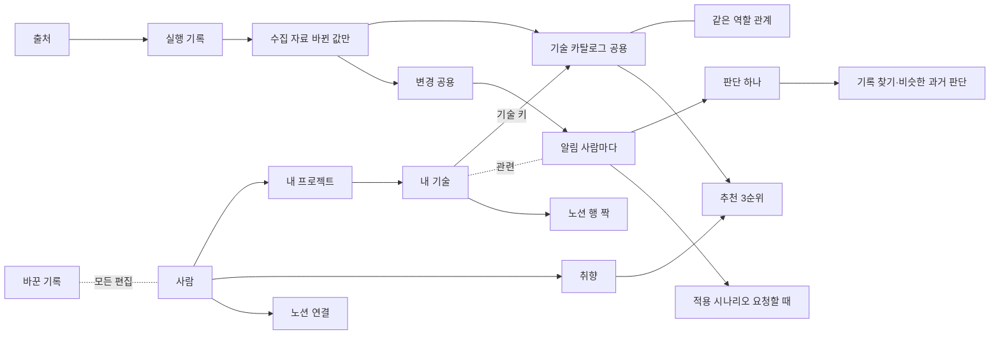

# 데이터설계 (관계와 권한)

> 상태: **초안, 팀 승인 전.** 데이터설계 인터뷰(2026-11-17, 팀원 1명, DS1·DS3–DS8 + 결정 질문 Q1–Q14 전부 추천대로)를 바탕으로 Claude가 썼다. 테이블 칸의 종류·키는 다음 문서 `docs/erd.md`에서 정한다. 여기서는 **무엇을 저장하고, 서로 어떻게 이어지고, 누가 읽고 고치는지**를 정한다.
> 함께 읽을 것: 8절(카탈로그에 넣는 기준), `docs/prd.md`(요구 PRD-F·NF), ADR 0007(노션), ADR 0008(개발 전에 정한 뿌리 결정), CLAUDE.md 3절 불변 규칙

## 0. 한눈에

## 1. 정한 원칙

| # | 원칙 | 이유 | 출처 |
|---|---|---|---|
| 1 | **기술 카탈로그는 공용** 하나. 사람마다의 "내 기술"은 카탈로그를 가리키는 줄이다. 이름만 직접 추가한 기술은 카탈로그를 가리키지 않고 이름만 저장한다 | 등급·지도 연결을 한 번 계산해 모두에게 쓴다 | DS1 |
| 2 | **기술 신분증(기술 키)**은 생태계와 이름으로 정한다(7절). 이름이 비슷한지로 맞추지 않는다 | 저장소 읽기 → 카탈로그 → OSV 조회 → 중복 막기가 AI 없이 같은 결과로 이어진다. 이전 프로젝트는 이름 맞추기에서 오탐이 많았다 | Q7, ADR 0008 |
| 3 | **"내 기술"은 AI 코딩 도구만**: MCP 서버, 스킬, 플러그인, LLM·에이전트 SDK. 나머지 의존성(react 등)은 v1에서 읽지 않는다 | 일반 의존성까지 넣으면 Dependabot과 같아진다(문제정의 10절 접은 후보) | Q8, ADR 0008 |
| 4 | **사건은 두 층**: 바깥 변화는 **변경** 한 줄(공용), 그 기술을 쓰는 사람마다 **알림** 한 줄 | 같은 변경은 한 번만, 알림은 "사람 + 변경" 쌍 하나만 → 불변 3을 DB 중복 금지로 지킨다 | DS3 |
| 5 | **알림 하나에 판단 하나.** 알림 상태는 판단이 저장된 뒤에만 "완료"가 된다 | 저장 실패 시 판단 대기가 그대로 남는다(불변 4) | DS4 |
| 6 | **적용 시나리오는 요청할 때만** 만든다(판단 전후 언제든). 저장만 하고 아무것도 바꾸지 않는다 | 비용 절약, 불변 1과 부딪히지 않음 | Q2 |
| 7 | **지우지 않고 보관**: 프로젝트를 지우면 "보관"으로 숨긴다. 판단 기록은 남는다 | 기록 찾기·비슷한 과거 판단에 계속 쓴다 | DS5 |
| 8 | **바꾼 기록은 한 테이블**에 덧붙이기만: 관리자가 한 일 + 사용자의 기술 목록 편집 | 안내서의 "작성자·시각"과 관리자의 "담당자·시각·사유"를 한 곳에서 | DS6 |
| 9 | **수집 자료는 바뀐 값만** 새 줄로. 실행 기록은 항상 남긴다 | 안내서: 변화 없으면 수집 기록만 남기고 사건은 만들지 않음 | DS8 |
| 10 | **노션은 테이블 둘**(연결, 보내기 기록) + 내 기술 ↔ 노션 행 짝. 토큰은 Supabase Vault | 여러 번 보내도 행이 두 번 생기지 않음(불변 3). 토큰은 화면에서 아무도 못 읽음 | DS7, ADR 0007 |
| 11 | **이전 프로젝트("tech-radar-agent")의 데이터는 가져오지 않는다.** 로직만 TypeScript로 옮긴다(6절) | 기술 292개의 대부분이 일반 IT 제품이고 설명 1,731건이 모두 미확인, 같은 역할 관계는 3개뿐(2026-11-17 조회) | Q4 |
| 12 | **추천은 알림·판단과 따로**(3순위). 사건이 아니다 | 추천은 바깥 변화가 아님(문제정의 9절). 판단을 요구하는 알림이 늘면 소음 | Q1, 회의 D6 |
| 13 | **카탈로그는 관문 세 개를 거쳐 "얇게 / 두껍게" 두 단계로** 넣는다(8절). 두꺼운 기술만 등급 검사·비교·매일 추적 | 다 모으면 GitHub 한도와 Claude 비용이 바닥나고 지도가 읽히지 않는다(별 100개 이상만 해도 약 7,000개, 2026-11-17 실측) | C1–C5 |

## 2. 무엇을 저장하나

칸은 개념 수준이다(이름·종류·키는 `docs/erd.md`). **굵은 칸**은 중복을 막는 기준이다.

### A. 사람

| 테이블(가칭) | 한 줄 | 주요 칸 | 누가 만드나 |
|---|---|---|---|
| `profiles` | 사람 | 로그인 id(Supabase Auth), 표시 이름, **역할(user / admin)**, 로그인 방법(노션·이메일) | 가입할 때 서버 |
| `preferences` | 취향 (3순위) | 사람, 만드는 것, 쓰는 도구, 관심 분야(가입 질문 3개), 건너뜀 여부 | 사람 |

### B. 직접 입력

| 테이블 | 한 줄 | 주요 칸 | 누가 만드나 |
|---|---|---|---|
| `projects` | 내 프로젝트 | 주인, 이름, 종류(저장소 / **프로젝트 밖(내 컴퓨터)**), 공개 저장소 주소, 메모, 작성 시각, 보관 시각 | 사람(프로젝트 밖은 가입 때 서버가 자동) |
| `my_technologies` | 내 기술 목록의 한 줄 | 주인, 프로젝트, **기술 키**(카탈로그) 또는 직접 쓴 이름, 출처(저장소에서 읽음 / 직접 추가), 숨긴 시각, 어느 파일에서 읽었는지, 마지막으로 읽은 시각, **수집 오류 표시와 오류 종류** | 저장소 읽기(서버) 또는 사람 |

중복 막기: 한 프로젝트 안에서 **같은 기술 키는 한 줄.** 숨긴 줄은 지우지 않으므로, 다시 읽어도 새 줄이 생기지 않고 숨김이 유지된다.

### C. 기술 카탈로그 (공용)

| 테이블 | 한 줄 | 주요 칸 | 누가 만드나 |
|---|---|---|---|
| `technologies` | 기술 하나 | **기술 키**, 표시 이름, 종류(MCP / 스킬 / 플러그인 / SDK / 모델), 갈래, **깊이(얇게 / 두껍게)와 두껍게 된 이유**(내 기술 / 같은 역할 / 인기 / 공식), 한 줄 설명과 근거 링크, 저장소, 라이선스, 마지막 활동, 공식 여부, **인기 신호**(주간 다운로드, 별, 7일 증가, HN 점수, HF 점수)와 **갈래 안 점수·순위**, **현재 보안 등급·쉬운 이유·근거 링크·등급 규칙 버전**(두꺼운 기술만) | 수집(서버), 사용자 저장소 읽기에서 처음 본 기술 |
| `categories` | 갈래 나무 | 이름, 위 갈래 | 팀(처음 목록), 관리자 |
| `tech_relations` | 기술끼리의 관계 | 두 기술, 종류(v1은 **같은 역할** 하나), 근거 원문 인용, 만든 방법(규칙 / AI 제안 / 관리자), 확인 여부 | 규칙·AI 제안(서버), 관리자 확인 |

같은 역할 관계는 두 기술을 작은 키 먼저 저장해 한 쌍이 한 줄이다. AI가 제안한 관계는 **근거 인용이 원문에 그대로 있을 때만** 저장하고, 관리자 확인 전에는 "확인 전"으로 둔다(이전 프로젝트에서 AI 관계 정확도가 눈대중 70–75%였다).

### D. 수집

| 테이블 | 한 줄 | 주요 칸 | 누가 만드나 |
|---|---|---|---|
| `sources` | 출처 | 이름, 방법(공개 API / Firecrawl), 간격, 켜짐 여부. v1: **OSV, 공식 MCP 레지스트리, GitHub 저장소 정보, npm·PyPI 다운로드 수, Hugging Face, Hacker News** (+ Firecrawl 1곳, 3순위) | 팀 |
| `runs` | 실행 한 번 | 시작 방식(**예약 / 지금 실행 / 시뮬레이터 / 사용자 다시 읽기 / 채점**), 누가 시작, 상태, 시작·끝 시각, 처리 건수, 시도 횟수, 다음 시도 시각 | 서버 |
| `run_steps` | 실행 안의 단계 | 실행, 단계 이름(`flow/flow.json`의 상자), 들어온 것·나간 것 요약, 상태, **오류 종류**(시간 초과 / 네트워크 / 한도 초과 / 상태 코드 / 해석 실패), 오류 내용 | 서버 |
| `observations` | 수집 자료 | 출처, 대상 기술 키, 지표(등급, 최근 활동, 새 버전, 인기 등), **이전 값, 현재 값**, 수집 시각, 실행, 실제 수집 / 시뮬레이터 표시 | 서버 (값이 바뀌었을 때만) |

흐름 화면(IA-16)과 내 실행 기록(IA-11)은 `runs`·`run_steps`만 읽어서 그린다(불변 6).

### E. 사건과 판단

| 테이블 | 한 줄 | 주요 칸 | 누가 만드나 |
|---|---|---|---|
| `changes` | 변경 (공용) | 종류(보안 등급 바뀜 / 같은 역할 새 기술), 기술 키, 이전 값, 현재 값, 출처, 발견 시각, 수집 자료, **중복 막기 키(출처 + 대상 + 값)**, 시뮬레이터 표시 | 서버 (사건 기준을 넘을 때, 기준은 spec) |
| `alerts` | 알림 (사람마다) | 사람, 변경, 종류(**보안 경고 / 적용 기회**), 관련된 내 기술, 상태(**판단 대기 / 완료**), 대응안 초안과 출처, 비교표(적용 기회), 만든 시각. **사람 + 변경은 한 줄** | 서버 |
| `judgments` | 판단 | 알림(**알림당 하나**), 결과(적용 후보 / 보류), 이유(보류면 필수), 누가, 언제 | 사람 (본인 알림에만) |
| `scenarios` | 적용 시나리오 | 알림, 요청한 사람, 상태(만드는 중 / 완료 / 실패), 비교표·적용 단계·위험·되돌리기, 출처, 시각 | 요청하면 서버(Claude) |

"비슷한 과거 판단"(IA-7, UJ-9)은 따로 저장하지 않고, 같은 기술·같은 역할 기술에 대한 내 `judgments`를 찾아 보여 준다.

### F. 추천 (3순위)

| 테이블 | 한 줄 | 주요 칸 | 누가 만드나 |
|---|---|---|---|
| `recommendations` | 추천 한 줄 | 사람, 기술, 추천 이유, 근거 신호와 출처, 만든 시각, 반응(관심 있음 / 없음 / 아직). **사람 + 기술은 한 줄** | 서버 |

### G. 노션 (알파 [D2])

| 테이블 | 한 줄 | 주요 칸 | 누가 만드나 |
|---|---|---|---|
| `notion_connections` | 노션 연결 (사람당 하나) | 사람, 워크스페이스 이름, 고른 페이지, 만든 데이터베이스, **토큰 → Vault 비밀 id**, 연결 시각 | 서버 |
| `notion_exports` | 보내기 한 번 | 사람, 미리보기 수(추가·고침·그대로), 결과 수(성공·실패), 상태, 시각 | 서버 (사람이 확인을 누른 뒤) |
| `notion_rows` | 내 기술 ↔ 노션 행 짝 | 내 기술, 노션 페이지 id, 마지막으로 보낸 값의 해시. **내 기술 하나에 짝 하나** | 서버 |

### H. 바꾼 기록, AI 호출, 위키 챗봇

| 테이블 | 한 줄 | 주요 칸 | 누가 만드나 |
|---|---|---|---|
| `audit_logs` | 바꾼 기록 (덧붙이기만) | 누가, 역할, 무엇을(직접 추가·숨김·되돌리기·지금 실행·분류 고치기·역할 바꾸기 등), 대상, 사유, 시각 | 서버 |
| `ai_calls` | Claude API 호출 기록 | 쓰는 곳(대응안 / 시나리오 / 분류 제안 / 챗봇), **입력 해시(같은 입력은 다시 보내지 않음)**, 토큰 수, 상태, 오류, 시각 | 서버 |
| `chat_logs` | 위키 챗봇 기록 | 누가, 질문, 찾은 위키 쪽, 답, 시각 | 서버 |

`ai_calls`로 하루 호출 한도와 연속 실패 시 쉬어 가기를 건다(이전 프로젝트의 방식). 챗봇의 하루 20개 한도는 `chat_logs`를 세서 건다.

### 채점

시뮬레이터 시나리오와 정답 사건 목록은 저장소의 파일로 둔다(`sim/`). 채점 결과는 `runs`(시작 방식 = 채점)와 결과 파일에 남긴다.

## 3. 어떻게 이어지나 (한 사람의 하루 기준)

| 여정 | 데이터가 지나는 길 |
|---|---|
| UJ-A3–A5 등록·목록 | `projects` → 저장소 읽기 `runs` → `my_technologies`(기술 키로 `technologies`에 연결, 없으면 카탈로그에 새로) → 직접 추가·숨김은 `audit_logs`에도 |
| 정기 수집 | `sources` → `runs`·`run_steps` → 값이 바뀌면 `observations` → `technologies`의 현재 값 갱신 → 사건 기준을 넘으면 `changes` |
| UJ-1–UJ-3 알림 | `changes` → 그 기술을 가진 사람마다 `alerts`(관련 `my_technologies` 연결) |
| UJ-5·6 판단 | `judgments` 저장 성공 → 같은 거래 안에서 `alerts.상태 = 완료`. 실패하면 둘 다 그대로 |
| 시나리오 요청 | `scenarios`(만드는 중) → Claude 호출 `ai_calls` → 완료 또는 실패 |
| UJ-8·9 기록 | `judgments` + `alerts` + `changes`를 읽어 기록 찾기, 같은 기술·같은 역할의 지난 판단 |
| 추천 (3순위) | `preferences` + `technologies`의 인기 신호·갈래 → `recommendations` |
| UJ-B1 노션 | `my_technologies`(숨김 제외) → 미리보기 → 확인 → `notion_exports` + `notion_rows`(짝이 있으면 고침, 없으면 추가) |
| UJ-M1–M3 관리자 | `runs`·`run_steps`의 수집 오류 → 지금 실행(`runs`, `audit_logs`) → 흐름 화면 |

## 4. 누가 읽고 고치나

**역할:** 사람(user) · 관리자(admin, 팀원) · 서버(서비스 키, 정기 실행·Claude 호출). 모든 테이블에 RLS를 켜고, 아래에 없는 것은 막는다(불변 5).

| 테이블 | 사람 (본인) | 관리자 | 서버 |
|---|---|---|---|
| `profiles` | 본인 읽기, 표시 이름 고치기. **역할은 못 바꿈** | 전체 읽기. 역할은 팀이 DB에서 직접(화면 없음) | 가입 때 만들기 |
| `preferences` | 본인 읽기·쓰기 | **못 봄**(취향은 개인 정보. 필요하면 합계만) | 읽기(추천 만들기) |
| `projects` | 본인 읽기·만들기·고치기·보관 | 전체 읽기(IA-12) | 프로젝트 밖 칸 만들기 |
| `my_technologies` | 본인 읽기, 직접 추가·숨김·되돌리기 | 전체 읽기, **고치기 못함** | 저장소 읽기 결과 쓰기 |
| `technologies`, `categories`, `tech_relations` | 모두 읽기 | 읽기, 갈래·관계 확인·고치기(`audit_logs` 남김) | 쓰기 |
| `sources` | 못 봄 | 읽기·켜고 끄기 | 읽기 |
| `runs`, `run_steps` | **본인이 시작한 다시 읽기만** 읽기(IA-11) | 전체 읽기, 지금 실행 | 쓰기 |
| `observations`, `changes` | 본인 알림에 붙은 것만 읽기 | 전체 읽기 | 쓰기 |
| `alerts` | 본인 읽기. **상태는 판단 저장으로만 바뀜** | 전체 읽기(IA-14). 고치기 못함 | 만들기 |
| `judgments` | **본인 알림에만 만들기**, 본인 읽기 | 읽기만. **만들기 못함**(불변 1) | 못 만듦 |
| `scenarios` | 본인 알림에 요청·읽기 | 읽기 | 쓰기(Claude 결과) |
| `recommendations` | 본인 읽기, 반응 고치기 | 못 봄 | 만들기 |
| `notion_connections` | 연결 상태(페이지·마지막 보낸 시각)만 읽기. **토큰은 아무도 못 읽음** | 못 봄 | 쓰기, Vault에서 토큰 꺼내기 |
| `notion_exports`, `notion_rows` | 본인 읽기 | 못 봄 | 쓰기 |
| `audit_logs` | 본인 줄 읽기 | 전체 읽기 | 쓰기만. **아무도 고치거나 지우지 못함** |
| `ai_calls` | 못 봄 | 읽기 | 쓰기 |
| `chat_logs` | 못 봄 | 읽기·질문(위키 챗봇은 관리자 = 팀원만) | 쓰기 |

## 5. 불변 규칙이 데이터에서 지켜지는 곳

| 불변 규칙 | 데이터에서 |
|---|---|
| 1 판단 전에 아무것도 실행 안 함, 관리자도 못 건너뜀 | `judgments`는 본인 알림에만 만들 수 있음. 노션 보내기는 사람의 확인 뒤에만 `notion_exports`. 관리자에게 `judgments` 쓰기 권한 없음 |
| 2 수집 실패는 "수집 오류" | `run_steps.오류 종류`, `my_technologies.수집 오류 표시`. 실패한 실행은 `observations`를 만들지 않아 "변화 없음"으로 보이지 않음 |
| 3 같은 변경은 한 번만 | `changes` 중복 막기 키, `alerts`의 사람 + 변경 하나, `notion_rows`의 내 기술 하나, `my_technologies`의 프로젝트 + 기술 키 하나 |
| 4 거절·저장 실패 시 기존 값 보존 | `judgments` 저장과 `alerts` 상태 변경을 한 거래로. 시나리오·노션 보내기는 실패 상태를 따로 남기고 "완료"로 표시하지 않음 |
| 5 권한은 화면·서버·DB에서 | 4절 표를 RLS로. 서버 키는 서버에만 |
| 6 흐름 화면은 실제 기록에서 | `runs`·`run_steps`만 읽음 |

## 6. 이전 프로젝트에서 옮기는 것

이전 개인 프로토타입(`C:\TechRadarAgent`, 파이썬)의 코드를 조사 도우미가 읽기만 해서 보고했다(`docs/agents.md` 2026-11-17). **데이터는 가져오지 않는다.**

| 옮길 로직 (TypeScript로 다시 씀) | 우리 쪽 쓰임 |
|---|---|
| URL 정리(`normalize_url`)와 내용 해시(`content_hash`) | `changes` 중복 막기 키 |
| HTTP 오류 분류(시간 초과·네트워크·한도 초과·상태 코드·해석 실패), 요청 사이 간격, 응답 크기 제한 | `run_steps.오류 종류` = 수집 오류 종류 |
| 실행 단위 재시도(2의 n제곱 분 뒤), 멈춘 작업 회수 | `runs.시도 횟수·다음 시도 시각` |
| 프롬프트 주입 막기: 자료를 표시로 감싸기, 답을 스키마로 다시 검사, 도구 안 넘김 | 대응안·시나리오·분류 제안·챗봇 |
| 같은 입력은 다시 보내지 않는 캐시, 하루 호출 한도, 연속 실패 시 쉬어 가기 | `ai_calls` |
| 관계에 원문 인용 요구, 설치 명령 인용은 버림 | `tech_relations` AI 제안 |
| 설명 칸과 근거 연결(한 줄 설명만) | `technologies.한 줄 설명과 근거 링크` |

**옮기지 않는 것:** Gemini 호출, 이전 웹 화면, RSS 수집, 이름 비슷한 것 찾기(fuzzy matching), 관계 9종류, 기술·설명·관계 데이터.

## 7. 기술 키와 "내 기술"을 읽는 규칙

| 어디서 보나 | 기술 키 예 | 내 기술로 넣는 기준 (v1) |
|---|---|---|
| `package.json` | `npm:@modelcontextprotocol/server-filesystem` | MCP 서버·LLM·에이전트 SDK로 알려진 패키지만(목록은 spec) |
| `requirements.txt` | `pypi:anthropic` | 위와 같음 |
| `.mcp.json` | `npm:…` / `pypi:…` / 없으면 `mcp:<레지스트리 이름>` | 모두 |
| `.claude/skills/<이름>/` | `skill:<owner>/<repo>/<이름>` | 모두 |
| `CLAUDE.md` | (설정 파일, 기술 아님) | 언급된 도구는 v1에서 읽지 않음 |
| 수집: GitHub 저장소 | `github:<owner>/<repo>` | — |
| 수집: Hugging Face | `hf:<id>` | — |
| 직접 추가(이름만) | 키 없음, 이름만 | 등급 "찾지 못함", 지도는 관리자 분류 확인 뒤 |

한 기술이 패키지와 저장소를 둘 다 가지면 패키지 키를 신분증으로 쓰고 저장소는 칸으로 둔다.

## 8. 카탈로그에 넣는 기준 (관문 셋, 얇게 / 두껍게)

전부 불러오지 않는다. 기술마다 **카탈로그에 넣을지**와 **얼마나 깊게 모을지**를 아래 관문으로 정한다.

### 관문 1: 우리 분야인가? → 통과하면 **얇게** 한 줄

| 들어오는 곳 | 넣는 기준 | 빼는 것 |
|---|---|---|
| 공식 MCP 레지스트리 | 모든 서버 | 사용 중단·삭제 표시된 서버 |
| 사용자 저장소 `.mcp.json`, `.claude/skills/` | 모두 | — |
| 사용자 저장소 `package.json`, `requirements.txt` | **허용 목록**에 있는 패키지만(LLM SDK, `@modelcontextprotocol/*`, 에이전트 프레임워크) | 일반 의존성 |
| GitHub | **주제 태그 목록**(`mcp-server`, `claude-code`, `agent-skills`, `claude-skills` 등)에 맞는 저장소 | 태그 없는 저장소 |
| Hugging Face | 코딩에 쓰는 작업 종류의 모델 | 이미지·음성 등 다른 작업 |
| Hacker News | **키워드 목록**에 맞고 GitHub 저장소나 패키지로 이어지는 글 | 이어지는 기술이 없는 의견·뉴스 |

얇은 줄에는 기술 키, 이름, 출처가 준 한 줄 설명, 출처 링크만 담는다. 등급 검사와 매일 다시 보기는 하지 않는다. 허용 목록·태그 목록·키워드 목록은 spec에서 처음 목록을 만들고, **관리자 분류 확인(IA-17)에서 더하거나 뺀다**(`audit_logs`에 남음).

### 관문 2: 누군가와 관련 있나? → 하나라도 맞으면 **두껍게**

| 두꺼워지는 이유 | 기준 | 인기와 상관 |
|---|---|---|
| 내 기술 | 누군가의 내 기술 목록에 있다(숨김 제외) | **상관없이 늘 추적**. 별 3개짜리 스킬도 보안 때문에 |
| 같은 역할 | 누군가의 내 기술과 같은 역할 관계가 있다(확인된 관계) | 상관없이 추적 |
| 공식 | 공식 조직(anthropics, modelcontextprotocol, openai 등)이 냈거나 공식 MCP 레지스트리에 등재 | 바로 통과 |
| 인기 | **갈래 안 점수 상위 20개** | — |

- **갈래 안 점수** = 사용량(주간 다운로드), 성장(별·다운로드 7일 증가, HF 인기 점수), 화제(HN 점수), 별 누적의 **같은 갈래 안 순위 평균.** 별 하나로 자르지 않는다. 규모가 작은 갈래(스킬)도 자기 갈래 안에서 경쟁한다.
- **12개월 넘게 활동이 없으면 인기에서 뺀다.** 내 기술·같은 역할이면 계속 추적한다.
- 20개와 12개월은 팀 추정이다. 첫 수집 뒤 실제로 몇 개가 들어오는지 세어 spec에서 고친다.
- 이유가 모두 사라지면(아무도 안 쓰고 순위 밖) 다시 **얇게** 돌아가고 매일 추적을 멈춘다. 지난 수집 자료와 판단 기록은 남는다.

두꺼운 기술에 모으는 것: 보안 등급 근거(OSV, 위험 패턴 검사, 최근 활동·라이선스), 인기 신호, 출처 붙은 한 줄 설명, 같은 역할 관계(원문 인용 필수). **모으지 않는 것:** 커뮤니티 댓글·평판 요약(ADR 0003), README 본문 전체(필요한 줄만 읽고 버림), 가격.

### 관문 3: 근거가 있나?

출처 링크가 없는 정보는 저장하지 않고 "찾지 못함"으로 둔다. AI가 만든 설명을 근거 없이 쌓지 않는다.

### 별만 쓰지 않는 이유 (2026-11-17 실측)

GitHub 검색 API로 센 저장소 수(태그끼리 겹침이 있어 합은 실제보다 큼): `mcp-server` 별 100+ 1,497 / 1,000+ 289, `claude-code` 3,573 / 779, `agent-skills` 1,305 / 340, `claude-skills` 570 / 147. 별 100으로 자르면 약 7,000개, 1,000이어도 1,500개 안팎이다. 별은 누적이라 오래된 것이 유리하고, 사용량이 아니며, 갈래마다 규모가 달라 숫자 하나로 공평하게 자를 수 없다. 사용량은 npm·PyPI 다운로드 API로 키 없이 잴 수 있다(오늘 확인).

## 9. 열린 질문

| # | 질문 | 언제 |
|---|---|---|
| DQ1 | 판단을 나중에 바꿀 수 있게 할지. 지금 설계는 "알림당 하나, 고치지 못함" | 회의 또는 spec |
| DQ2 | 허용 목록·GitHub 태그 목록·HN 키워드 목록·갈래의 처음 목록, 상위 20개·12개월 숫자 확인 | spec, 첫 수집 뒤 |
| DQ3 | 보안 등급 규칙(OSV + 위험 패턴 검사 + 저장소 정보)과 사건 기준 숫자 | spec |
| DQ4 | 수집 자료·AI 호출 기록을 얼마나 오래 둘지 | spec |
| DQ5 | Vercel 정기 실행 횟수와 함수 실행 시간 한도 (**확인하지 못함**) | 뼈대 |

## 바뀐 기록

- 2026-11-17 수집 기준 인터뷰(C1–C5 전부 추천대로): 관문 셋과 얇게/두껍게(8절), 인기는 갈래 안 순위·상위 20개, 공식은 바로 통과, 12개월 활동 없으면 인기에서 뺌, 출처에 npm·PyPI 다운로드 수 추가, `technologies` 칸 추가
- 2026-11-17 초안: 데이터설계 인터뷰 DS1·DS3–DS8, 결정 질문 Q1–Q14 전부 추천대로(팀원 1명). 공용 카탈로그 + 기술 키, 변경·알림 두 층, 판단 하나, 요청형 시나리오, 보관, 바꾼 기록 하나, 바뀐 값만, 노션 테이블, 추천(3순위), 권한 표, 불변 규칙 대응, 이전 프로젝트에서 옮길 로직. 팀 승인 전
